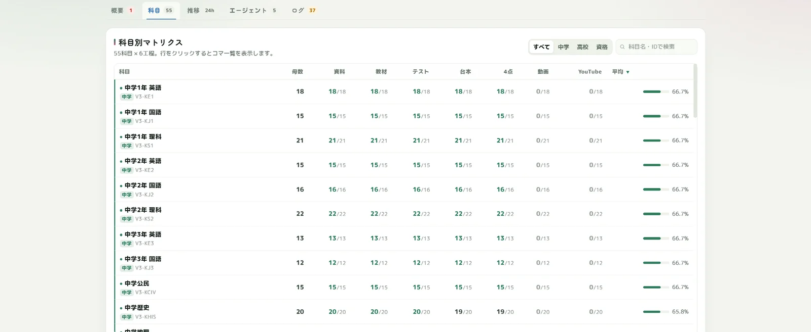
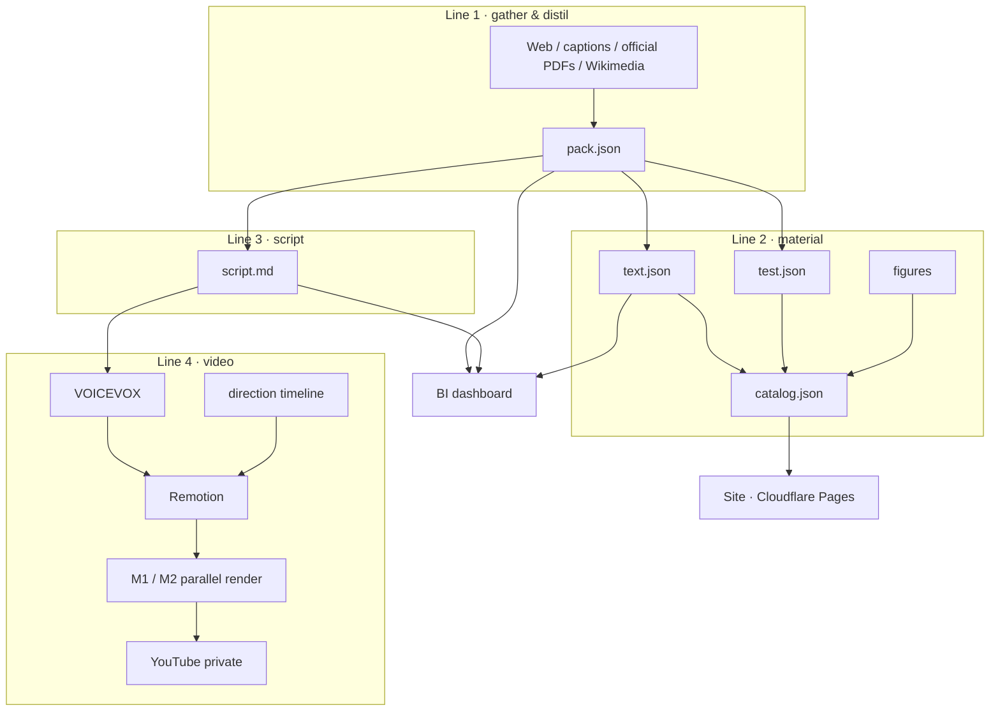

# AI Production Line

**A production line that turns curricula into video, web textbook and diagnostic test — as one set.**

Fifty-five subjects, 1,146 lessons, processed by **four independent CLI lines**:
source gathering, material generation, script writing and video rendering,
with a static site and a local BI dashboard on top.

[](https://github.com/RintaroMatsumoto/ai-production-line/actions/workflows/ci.yml)
[](https://www.python.org/)
[](requirements.txt)
[](LICENSE)

[日本語 README](README.md) · [Architecture](docs/01-architecture.md) · [Website](docs/07-website.md) · [BI](docs/08-bi-dashboard.md) · [Benchmarks](docs/05-benchmarks.md)

## What this is

One lesson is one folder. **File existence is the state.**

```bash
py パイプライン/line1_collect/batch_collect.py --limit 10
py パイプライン/line2_material/watch_material.py
py パイプライン/line3_script/watch_script.py
py パイプライン/line4_video/watch_video.py --machine m1
```

```
[Line 1: gather & distil] → pack.json
        ├→ [Line 2: material] → text.json / test.json / figures → auto deploy
        └→ [Line 3: script]   → script.md
                                 └→ [Line 4: video] → voice · direction · render → YouTube private
```

No resident workers, no queue, no approval ledger, no state machine.
Each line is a stateless CLI batch: rerun it and it resumes at the first
lesson that is not yet done.

## Numbers

| Metric | Result |
|---|---|
| Curriculum | **55 subjects / 237 chapters / 413 sections / 1,146 lessons** (~233 hours) |
| Source packs | **1,060 lessons** (92.5%) |
| Web textbooks | **488** (485 published) |
| Diagnostic tests | **465** (459 published) |
| Scripts | **509** |
| Render farm | 2 machines in parallel (concurrency 4 / 6) |
| BI | 1,146 lessons, one command |

## Three highlights

**1. Pipeline — four lines that hold no state.**
Where the previous version used a queue, a state machine and multi-stage review,
this one writes state to the filesystem. Progress is "does this file exist".
A failed lesson is logged and skipped; the line keeps going. The result is a
system that survives a kill, a reboot or a broken lesson without recovery work.

**2. Website — a static SPA + PWA with no login.**
1,146 lessons served from Cloudflare Pages with no server, no DB and no API.
Hash routing, KaTeX, localStorage-only progress, and a Service Worker for
offline use. Line 2 regenerates the catalog and deploys automatically.

**3. BI — 1,146 lessons in one command.**
A local dashboard built on the Python standard library only. Five tabs,
a 55 × 6 stage matrix, line health from process command lines and artifact
mtimes, alerts, cost tracking, and a bundled Chart.js for offline use.
It is strictly read-only: a bug in the dashboard cannot stop production.



## Architecture



## Quick start

No runtime dependencies.

```bash
python -m src.pipeline.lines --root samples/lessons --line line2 --dry-run
python -m src.pipeline.progress --root samples/lessons

python samples/make_demo_audio.py
python -m src.pipeline.gates.audio_freshness \
  --scenes samples/scenes.example.json --audio-dir samples/audio
python -m src.pipeline.gates.visual_layout samples/layout.example.json

python -m unittest discover -s tests -v
```

Edit one `text` in `samples/scenes.example.json` and run the gate again:
that single scene is reported as stale. That is the failure class the gate exists for.

## What is not included

A public edition of two private projects. Removed: source material, third-party
content, commercially distributed products, credentials, internal hostnames,
production prompts and character assets.

## License

Code: [MIT](LICENSE). Documentation: CC BY 4.0.

---

**Rintaro Matsumoto** — 22 years in the Japan Ground Self-Defense Force working
on communications infrastructure and combat simulation systems. Currently
building AI-driven content production infrastructure.
