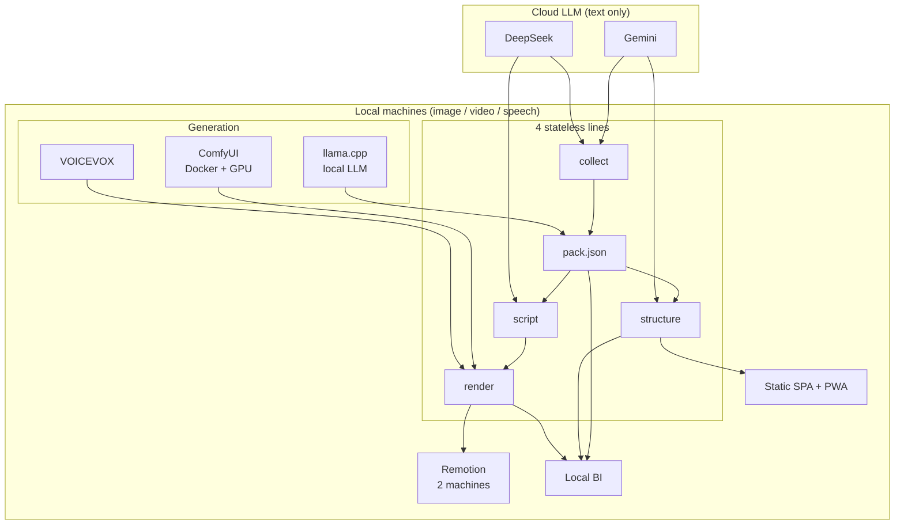

# AI Production Line

**Heavy generation on local GPUs, lightweight inference in the cloud. Each step is placed where it belongs.**

Image and video generation with ComfyUI in Docker, speech synthesis, rendering,
a delivery layer and an operations dashboard — in one repository.
Images, video and speech never touch an external generation API.
Text generation does use cloud models, because that is where the quality is.

[](https://github.com/RintaroMatsumoto/ai-production-line/actions/workflows/ci.yml)
[](https://www.python.org/)
[](requirements.txt)
[](LICENSE)

[日本語 README](README.md) · [Architecture](docs/01-architecture.md) · [Generation](docs/03-video-pipeline.md) · [Delivery](docs/07-website.md) · [BI](docs/08-bi-dashboard.md) · [Conversation-memory RAG](docs/09-conversation-memory-rag.md)

## Where each step runs

Neither "everything local" nor "everything in the cloud" — the split follows the workload.

| Step | Runs on | Why |
|---|---|---|
| Image generation | **Local** (ComfyUI / Docker) | Many attempts; per-call pricing makes cost unpredictable |
| Video generation | **Local** | Same, plus inputs stay on the machine |
| LoRA training | **Local** | Models and datasets are too large to move |
| Speech synthesis | **Local** (VOICEVOX) | Low latency, free, works offline |
| Video assembly | **Local** (Remotion) | Asset transfer would dominate |
| Text generation (design, writing) | **Cloud LLM** | 12GB of VRAM cannot reach the quality that decides the output |
| Text generation (bulk preprocessing) | **Cloud LLM (cheap)** | Unit price matters; faster and cheaper than local |
| Local LLM | **Local** (llama.cpp) | Sensitive work, and a fallback if the cloud is unavailable |
| Delivery | Static hosting | No servers to operate |
| Source collection | External sources | Primary material has to be fetched |

The rule is simple: **the steps whose cost scales with attempts stay local.**
Text is low-volume and its quality sets the quality of everything downstream, so it goes to frontier models.

## Stack

| Layer | Technology |
|---|---|
| Image / video generation | **ComfyUI in Docker** (ai-dock base), SDXL, Flux, Wan 2.2, AnimateDiff |
| Consistency | LoRA (kohya_ss), IP-Adapter FaceID, ControlNet, ReActor |
| Post-processing | Real-ESRGAN, RIFE frame interpolation, LivePortrait / SadTalker / Wav2Lip |
| LLM (local) | llama.cpp (125B MoE, 256K context, 12GB VRAM) |
| LLM (cloud) | Gemini, DeepSeek (text and bulk preprocessing) |
| Speech | VOICEVOX (local HTTP) |
| Video assembly | Remotion (React → MP4) |
| Orchestration | Python (standard library only) |
| Delivery | Static SPA + PWA (no server) |
| Observability | Local BI (stdlib + bundled Chart.js) |
| Runtime | Docker with GPU passthrough, Windows 11 |

## Measured numbers

| Metric | Value | Environment |
|---|---|---|
| Image generation | **~4 s / image** | RTX 3080 10GB, SDXL |
| Image generation | ~12 s / image | RTX 3060 12GB, SDXL |
| Video generation | **~5 s / clip** | RTX 3080, Wan 2.2 TI2V 5B, 832×480 |
| Video generation | ~10 s / clip | RTX 3060, same model |
| LoRA training | 2.40 s/it | RTX 3060, SDXL, kohya_ss |
| Local LLM inference | 10.8 t/s @ 256K context | RTX 3060, 125B MoE |
| Video render | 2 machines in parallel | Remotion |
| External APIs for image/video/speech | **0** | all local |

## Three highlights

**1. ComfyUI as a reproducible Docker service.**
One image, two machines. Custom-node dependencies pinned, Triton + SageAttention
for a 20–30% speedup, models and outputs on separate named volumes, and
`--lowvram --force-fp16` to fit 10–12GB of VRAM.

**2. Generation as a line, not a session.**
Four independent CLI stages, no queue, no workers, no state machine.
Progress is file existence. A failed unit is logged and skipped; the line keeps going.
Rerunning resumes at the first unfinished unit.

**3. Generation, delivery and observability in one loop.**
Outputs ship as a static SPA + PWA (no DB, no API), and a one-command local BI
shows per-stage progress, line health, cost and failures.

## Related project: conversation-memory RAG

Separately from this pipeline, I run a local RAG that indexes development sessions so a new session can resume with prior context.

It fuses three lanes with RRF: SQLite FTS5 (Japanese bigram), multilingual-e5-small (384 dimensions, float16), and a recency lane. Chunks are 700 characters with 100-character overlap, deduplicated with SHA-256, secrets are redacted, and injection is capped at 3,500 characters once per session.

| Metric | Value |
|---|---:|
| Indexed sessions | 254 |
| Chunks | 30,198 |
| Index DB | 259.8 MB |
| Incremental indexing | every 15 minutes |

Details: [docs/09-conversation-memory-rag.md](docs/09-conversation-memory-rag.md) (Japanese).

## Architecture



## Quick start

No runtime dependencies.

```bash
python -m src.pipeline.lines --root samples/lessons --line line2 --dry-run
python -m src.pipeline.progress --root samples/lessons

python samples/make_demo_audio.py
python -m src.pipeline.gates.audio_freshness \
  --scenes samples/scenes.example.json --audio-dir samples/audio
python -m src.pipeline.gates.visual_layout samples/layout.example.json

python -m unittest discover -s tests -v
```

## What is not included

A public edition of a private system. Removed: model files and LoRAs, source
material, generated output, credentials, internal hostnames, production prompts
and character definitions. The conversation-memory RAG implementation itself is
not included; only its design and measurements are in `docs/09`.

Included: design decisions, the Docker setup, generalized implementations,
measured numbers, and a failure log.

## License

Code: [MIT](LICENSE). Documentation: CC BY 4.0.

---

**Rintaro Matsumoto** — 22 years in the Japan Ground Self-Defense Force working
on communications infrastructure and combat simulation systems. Currently
building local-first generative media infrastructure.
