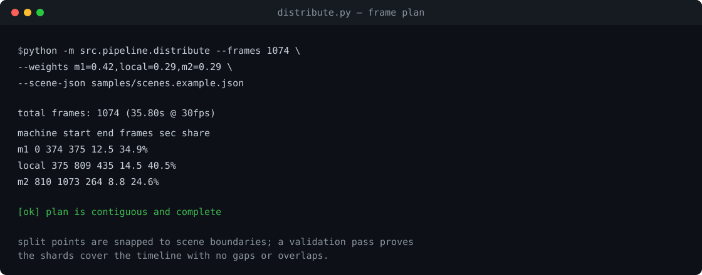
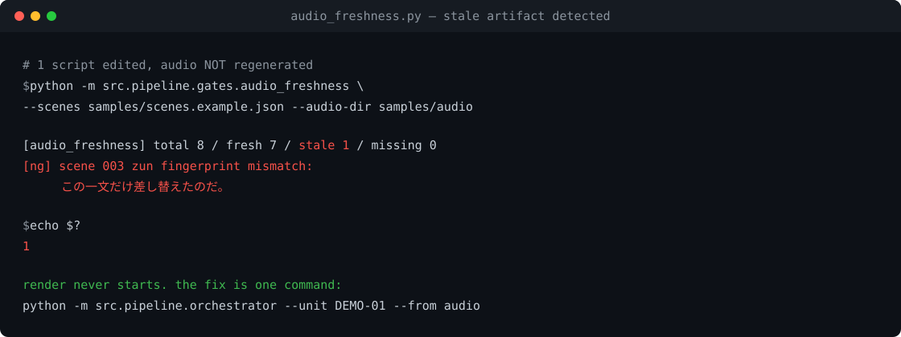

# AI Production Line

**Turns "make one video" into "operate a production line" — local LLMs plus distributed rendering.**

A 16-stage pipeline that goes from script generation to rendering, quality
gating and publishing, distributing renders across 2–3 GPU machines to produce
a 20-minute explainer video in **11–16 minutes**.

[](https://github.com/RintaroMatsumoto/ai-production-line/actions/workflows/ci.yml)
[](https://www.python.org/)
[](requirements.txt)
[](LICENSE)

[日本語 README](README.md) · [Architecture](docs/01-architecture.md) · [Benchmarks](docs/05-benchmarks.md) · [Lessons](docs/06-lessons.md)

---

## What this is

```bash
python -m src.pipeline.orchestrator --unit U-M-I-01
```

```
lecture → survey → spec → design → script → quality
        → scene → visuals → reading → audio → assets
        → presentation → thumbnail → render → qa → progress
```

Every stage produces a verified artifact. When a gate fails, the pipeline
stops — it does not continue with output that merely *looks* successful.

## Numbers

| Metric | Result |
|---|---|
| Pipeline stages | **16** (each resumable) |
| Units managed | **777** |
| Source pages indexed | **11,669** (full-text search) |
| Render, 2 machines | **15.7 min** per 19.6-min video |
| Render, 3 machines | **11.2–12.7 min** |
| Gate pass rate | **95%** (19/20 rubric) |

## Three technical highlights

**1. A 125B MoE model at 256K context on a 12GB GPU.**
Quantized weights plus Q8_0 KV cache reach 10.8 t/s. Mixing K/V quantization
silently disables Flash Attention and collapses throughput to 0.70 t/s at 4K
context — no error, no warning.

**2. Distributed rendering that snaps to scene boundaries.**
Frame ranges are split by measured throughput ratio, but split points are
forced onto scene starts. Splitting mid-line produces a broken concat with exit
code 0; snapping plus a ±0.2s duration check eliminates it.



**3. Gates that detect stale artifacts.**
The worst failure mode in automation is not a crash — it is an old file that
looks new. Audio files carry a SHA256 fingerprint of the text, speaker and
synthesis parameters, so a render cannot proceed when the script changed but
the audio did not.



## Repository layout

```
docs/     design notes, benchmarks, and a failure log
src/      runnable reference implementations (stdlib only)
tests/    unittest suite, no external dependencies
samples/  example scene, layout and pipeline config
```

## Quick start

```bash
python samples/make_demo_audio.py

python -m src.pipeline.distribute --frames 35230 \
  --weights m1=0.42,local=0.29,m2=0.29 --scene-json samples/scenes.example.json

python -m src.pipeline.gates.audio_freshness \
  --scenes samples/scenes.example.json --audio-dir samples/audio

python -m src.pipeline.orchestrator --unit DEMO-01 --dry-run

python -m unittest discover -s tests -v
```

Try breaking the freshness gate: edit any `text` in
`samples/scenes.example.json` and run the gate again. The unchanged WAV is now
reported as stale — exactly the bug the gate was built for.

## What is not included

This is a public edition of two private projects. Removed: third-party
copyrighted material, commercially distributed content, credentials, internal
hostnames and production prompts.

## License

Code: [MIT](LICENSE). Documentation: CC BY 4.0.

---

**Rintaro Matsumoto** — 22 years in the Japan Ground Self-Defense Force working
on communications infrastructure and large-scale simulation systems. Currently
building AI-driven content production infrastructure.
