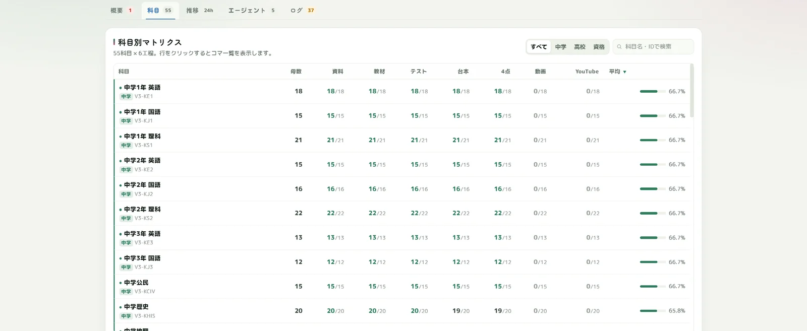
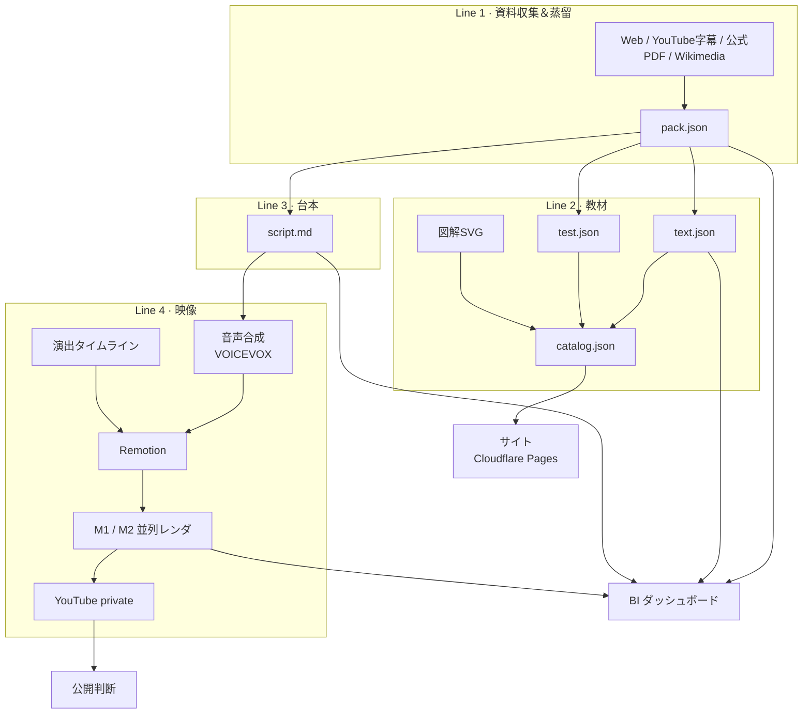

# AI Production Line

**学習コンテンツを「動画・Webテキスト・診断テスト」の3点セットで量産する制作基盤。**

55科目・1,146コマのカリキュラムを、**4つの独立したCLIライン**で処理します。
資料収集から教材生成、台本、映像レンダリング、サイト公開、進捗の可視化まで、
人間の確認を最小限にしたパイプラインです。

[](https://github.com/RintaroMatsumoto/ai-production-line/actions/workflows/ci.yml)
[](https://www.python.org/)
[](requirements.txt)
[](LICENSE)

[English README](README.en.md) · [アーキテクチャ](docs/01-architecture.md) · [ウェブサイト](docs/07-website.md) · [BI](docs/08-bi-dashboard.md) · [実測値](docs/05-benchmarks.md)

> **作った人**：松本 倫太郎。陸上自衛隊で22年間、通信インフラと戦闘シミュレーションシステムの開発に従事。IT実務24年。

## これは何か

1コマ＝1フォルダ。**ファイルの有無が、そのまま進捗**です。

```bash
py パイプライン/line1_collect/batch_collect.py --limit 10
py パイプライン/line2_material/watch_material.py
py パイプライン/line3_script/watch_script.py
py パイプライン/line4_video/watch_video.py --machine m1
```

```
[Line 1: 資料収集＆蒸留] → pack.json
        ├→ [Line 2: 教材] → text.json / test.json / 図 → サイト自動デプロイ
        └→ [Line 3: 台本] → script.md
                              └→ [Line 4: 映像] → 音声・演出・レンダ → YouTube private
```

常駐ワーカー、進行役、独自キュー、承認台帳、状態機械は**置いていません**。
各ラインはステートレスなCLIバッチで、中断しても再実行すれば未処理のコマから再開します。

## 数字（実測）

| 項目 | 実績 |
|---|---|
| カリキュラム | **55科目 / 237章 / 413節 / 1,146コマ**（約233時間・学習指導要領/シラバス1,576項目を100%網羅） |
| 資料パック生成 | **1,060コマ**（92.5%） |
| Webテキスト | **488コマ**（うち公開 485） |
| 診断テスト | **465コマ**（うち公開 459） |
| 台本 | **509コマ** |
| 映像レンダ | M1 / M2 の**2台並列**（concurrency 4 / 6） |
| BI | 1,146コマを**1コマンド**で可視化 |

> 数値は2026年11月時点のスナップショットです。映像ラインは移行直後のため、動画本数はこれから伸びる段階にあります。

## 3つの技術的ハイライト

### 1. パイプライン全体 — 「状態を持たない」4ライン

前バージョンは、常駐ワーカー・独自キュー・承認台帳・多段査読で縛る構成でした。
流量が増えるほど詰まり、障害時の復旧コストが支配的になります。

現行版は**状態をファイルに逃がしました**。

| 判断 | 現行の方式 |
|---|---|
| どこまで進んだか | `pack.json` / `text.json` / `script.md` の有無 |
| 次に何をするか | 未処理のコマを**若い番号から**再スキャン |
| 失敗したら | エラーログを残して**即スキップ**し、ラインは止めない |
| やり直したいとき | `--force` を付けたコマだけ上書き |
| 品質保証 | 機械チェック＋**最大1回**の自動リトライ |

「状態機械を正しく保つ」問題を、「ファイルがあるか見る」問題に置き換えた形です。
プロセスを殺しても、電源を落としても、進捗は壊れません。

### 2. ウェブサイト — ログイン不要の静的SPA＋PWA

1,146コマの参考書型テキストと診断テストを、**サーバーなし**で配信します。

- Cloudflare Pages の静的ホスティング。DBもAPIもなし
- 4階層ナビ（科目 → 章 → 節 → コマ）をハッシュルーティングで実現
- 数式は KaTeX、進捗とテスト履歴は `localStorage` のみ
- Service Worker でコアシェルをキャッシュし、**オフラインでも開ける**
- 2テーマ（緑／桃）、通知表、赤シートモード、学習ポイント

教材生成（Line 2）が `catalog.json` を更新し、デプロイまで自動で流れます。

### 3. BIツール — 1,146コマを1コマンドで見る

制作状況を可視化するローカルダッシュボードです。**Python標準ライブラリのみ**で動きます。

```bash
py run_bi.py     # → http://127.0.0.1:8787
```

- **5タブ**：概要 / 科目 / 推移 / エージェント / ログ
- **科目マトリクス**：55科目 × 6工程を母数付き（`18/18`）で表示、検索・絞込・ソート
- **ライン監視**：稼働／滞留／停止を、実行中プロセスのコマンドラインと成果物の更新時刻から判定
- **アラート**：停止・滞留・サイト未反映・失敗・ディスク残量を自動判定
- **コスト**：ライン別・モデル別の累計USD
- Chart.js を同梱し、**オフライン動作**。127.0.0.1 のみで待受

「どの科目が、どの工程で、どこまで進んでいるか」を答えるために作りました。
進捗の正はファイルの有無で、UIはそれを読むだけです。



### 補足：ローカルLLMの運用知見

制作基盤の前段として、12GBのGPUで125B MoEモデルを256Kコンテキストで動かす検証も行っています。
KVキャッシュの量子化を混在させるとFlash Attentionが無効化され、15倍遅くなる現象を特定しました。
詳細は [docs/02-local-llm.md](docs/02-local-llm.md)。

## アーキテクチャ



詳細は [docs/01-architecture.md](docs/01-architecture.md)。

## リポジトリ構成

```
.
├── README.md
├── docs/
│   ├── 01-architecture.md      4ライン設計・状態を持たない理由
│   ├── 02-local-llm.md         ローカルLLM運用（量子化・KV・スループット）
│   ├── 03-video-pipeline.md    Line 4 映像パイプライン
│   ├── 04-quality-gates.md     機械チェックと著作権ガード
│   ├── 05-benchmarks.md        実測値と測定条件
│   ├── 06-lessons.md           失敗と対策の記録
│   ├── 07-website.md           静的SPA＋PWAの設計
│   └── 08-bi-dashboard.md      BIの指標定義と実装
├── src/
│   ├── pipeline/
│   │   ├── lines.py            ステートレスなライン実行の参照実装
│   │   ├── progress.py         ファイル有無から進捗を計算
│   │   ├── distribute.py       フレーム分割の配分計画
│   │   └── gates/
│   │       ├── audio_freshness.py
│   │       └── visual_layout.py
│   └── llm/
│       ├── benchmark.py
│       └── healthcheck.py
├── tests/                      unittest（外部依存なし）
└── samples/                    設定例・シーン例
```

## クイックスタート

実行時依存はありません（Python標準ライブラリのみ）。

```bash
# ライン実行の計画を表示（実際には何もしない）
python -m src.pipeline.lines --root samples/lessons --dry-run

# 進捗を計算（BIと同じ指標）
python -m src.pipeline.progress --root samples/lessons

# ゲートのデモ
python samples/make_demo_audio.py
python -m src.pipeline.gates.audio_freshness \
  --scenes samples/scenes.example.json --audio-dir samples/audio
python -m src.pipeline.gates.visual_layout samples/layout.example.json

# テスト
python -m unittest discover -s tests -v
```

> `python` が使えない環境では `py` に読み替えてください。

## 実測値（抜粋）

| 項目 | 値 | 条件 |
|---|---|---|
| 資料収集バッチ | 468コマ / 約4〜6時間 | 直列＋クールダウン（429回避） |
| Webテキスト生成 | 488コマ | DeepSeek V4.1 Flash |
| 映像レンダ | M1 / M2 並列 | Remotion 1920×1080 / 30fps |
| ローカルLLM | 10.8 t/s @ 256K ctx | RTX 3060 12GB / 125B MoE |

条件と再現手順は [docs/05-benchmarks.md](docs/05-benchmarks.md)。

## この公開版について

2つの個人プロジェクトで実際に稼働しているシステムの**公開用エディション**です。

含めていないもの：教材の原資料・過去問題・第三者コンテンツ、商用配布物、
認証情報、内部ホスト名、実運用のプロンプト全文、キャラクター素材。

含めているもの：設計判断とその理由、一般化した実装、実測値、
そして失敗の記録（[docs/06-lessons.md](docs/06-lessons.md)）。

## ライセンス

コードは [MIT](LICENSE)。ドキュメントは CC BY 4.0。

---

**Author** — 松本 倫太郎 / Rintaro Matsumoto
陸上自衛隊で22年間、通信インフラと戦闘シミュレーションシステムの開発に従事。
現在はAIを活用したコンテンツ生産基盤の設計・運用に取り組んでいます。
