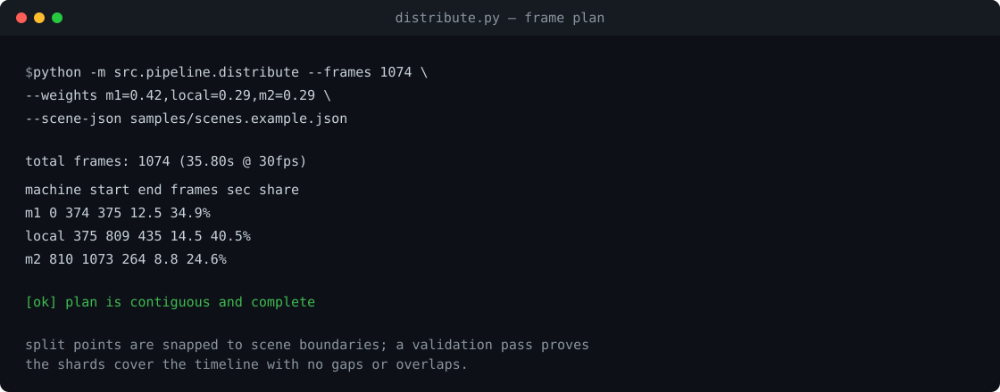
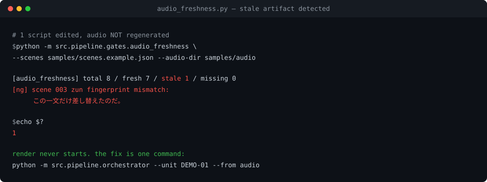
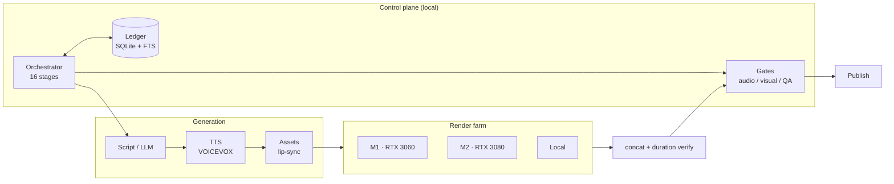

# AI Production Line

**ローカルLLM × 分散レンダリングで、解説動画を「1本ずつ作る」から「生産する」に変えるパイプライン。**

台本生成から映像レンダリング、品質検査、公開までを16ステージで自動化し、
2〜3台のGPUマシンに処理を分散させて1本あたり **11〜16分** で書き出す個人開発プロジェクトです。

[](https://github.com/RintaroMatsumoto/ai-production-line/actions/workflows/ci.yml)
[](https://www.python.org/)
[](requirements.txt)
[](LICENSE)
[](tests/)

[English README](README.en.md) · [アーキテクチャ](docs/01-architecture.md) · [実測値](docs/05-benchmarks.md) · [失敗と対策](docs/06-lessons.md)

> **作った人**：松本 倫太郎。陸上自衛隊で22年間、通信インフラと戦闘シミュレーションシステムの開発に従事。IT実務24年。

---

## これは何か

教材コンテンツ（単元777件）を題材に、以下を1コマンドで回します。

```bash
python -m pipeline.orchestrator --unit U-M-I-01
```

```
lecture → survey → spec → design → script → quality
        → scene → visuals → reading → audio → assets
        → presentation → thumbnail → render → qa → progress
```

各ステージの出力は**成果物として検証**され、ゲートを落ちると次に進みません。
「動画はできたが中身が古い」「図が見切れている」「音声だけ前の台本のまま」といった
**自動化でよく壊れる箇所を、機械的に止める**設計にしています。

## 数字

| 項目 | 実績 |
|---|---|
| パイプライン | **16ステージ**（全ステージ再開可能） |
| 管理単元 | **777** |
| 素材カード | **1,808** |
| 取り込み済み参考資料 | **11,669ページ**（全文検索DB） |
| レンダ分散 | 2台 **15.7分/本** / 3台 **11.2〜12.7分/本** |
| 品質ゲート合格率 | **95%**（19/20点基準） |
| 公開済み成果物 | YouTube **30本以上** |

> 実測環境と条件は [docs/05-benchmarks.md](docs/05-benchmarks.md) に記載しています。

## このリポジトリが示していること

| 領域 | 内容 |
|---|---|
| **分散システム設計** | 1本の動画を複数マシンに分割し、意味のある境界で切って、検証して結合する |
| **検証設計** | 「落ちるべき時に落ちる」ゲートを設計し、自動化の失敗モードを封じる |
| **性能チューニング** | 12GBのGPUという制約下で、量子化とメモリ配置を実測で詰める |
| **ドキュメント** | 判断の理由と失敗を、半年後の自分が読める形で残す |

## 3つの技術的ハイライト

### 1. 12GBのGPUで125B MoEモデルを256Kコンテキストで動かす

量子化モデル（UD-Q2_K_XL）とKVキャッシュ量子化（Q8_0）の組み合わせで、
VRAM 12GBのコンシューマGPU上に **256Kコンテキスト / 10.8 t/s** の推論基盤を構築。

検証の結果、**KとVで異なる量子化を混ぜるとFlash Attentionが無効化され、
長文脈で0.7 t/sまで性能が落ちる**ことを特定しました（同一量子化なら10.84 t/s）。
この知見は [docs/02-local-llm.md](docs/02-local-llm.md) にまとめています。

### 2. シーン境界にスナップする分散レンダ

1本の動画をフレーム範囲で分割して複数マシンに投げ、最後に `ffmpeg concat` で結合します。
分割点を**必ずシーン境界（無音域）にスナップ**させることで、結合箇所の音切れを防ぎます。

- 配分は実測スループット比による重み付け（`m1=0.42, local=0.29, m2=0.29`）
- 結合後に **尺を実測検証**（期待値 ±0.2秒）
- 継ぎ目16フレームのMD5がマシン間で完全一致することを確認済み



### 3. 「古い成果物」を検出するゲート

自動化で最も危険なのは、**失敗ではなく「成功したように見える古い出力」**です。

実例：読み辞書を修正したのに音声ステージを飛ばしてレンダしたため、
242本のWAVが旧辞書のまま動画に残りました（「空集合」→「そらしゅうごう」）。
テキストを検査する既存の監査では検出できません。

対策として、シーン・読み辞書・合成パラメータから**指紋（SHA256）**を計算し、
実在するWAVの指紋と突合する `audio_freshness` ゲートを実装しました。
レンダ前に必ず落ちるため、同種の事故は再発していません。



## アーキテクチャ



詳細は [docs/01-architecture.md](docs/01-architecture.md)。

## リポジトリ構成

```
.
├── README.md
├── docs/
│   ├── 01-architecture.md      全体設計と責務分離
│   ├── 02-local-llm.md         ローカルLLM運用（量子化・KV・スループット）
│   ├── 03-video-pipeline.md    16ステージと分散レンダ
│   ├── 04-quality-gates.md     品質ゲートの設計
│   ├── 05-benchmarks.md        実測値と測定条件
│   └── 06-lessons.md           失敗と対策の記録
├── src/
│   ├── llm/
│   │   ├── benchmark.py        OpenAI互換APIのスループット/品質ベンチ
│   │   ├── healthcheck.py      推論サーバーの疎通確認
│   │   └── serve_llama.example.bat
│   └── pipeline/
│       ├── orchestrator.py     ステージ実行・再開・ゲート
│       ├── distribute.py       フレーム分割の配分計画
│       └── gates/
│           ├── audio_freshness.py
│           └── visual_layout.py
├── tests/                      unittest（外部依存なし）
└── samples/                    設定例・シーン例
```

## クイックスタート

外部依存なしで、配分計画とゲートの動作を確認できます。

```bash
# デモ用の音声と指紋ファイルを生成（無音WAV）
python samples/make_demo_audio.py

# 分散レンダの配分計画を表示（実際にはレンダしない）
python -m src.pipeline.distribute \
  --frames 1074 \
  --weights m1=0.42,local=0.29,m2=0.29 \
  --scene-json samples/scenes.example.json

# 音声鮮度ゲート
python -m src.pipeline.gates.audio_freshness \
  --scenes samples/scenes.example.json --audio-dir samples/audio

# 図解レイアウトゲート
python -m src.pipeline.gates.visual_layout samples/layout.example.json

# オーケストレータのドライラン（16ステージの構成を表示）
python -m src.pipeline.orchestrator \
  --unit DEMO-01 --config samples/config.example.json --dry-run

# テスト（外部依存なし）
python -m unittest discover -s tests -v
```

### ゲートが落ちる様子を見る

`samples/scenes.example.json` の `text` を1つだけ書き換えて、もう一度ゲートを実行してください。
WAVは変わっていないので、**そのシーンだけが `stale` として検出**されます。
これがこのゲートの目的です。

> `python` が使えない環境では `py` に読み替えてください。

ローカルLLMのベンチマーク（llama.cpp / vLLM など OpenAI互換サーバーが起動済みの場合）:

```bash
python -m src.llm.benchmark --base-url http://127.0.0.1:8080 --model my-model
```

## 実測値（抜粋）

| 項目 | 値 | 環境 |
|---|---|---|
| 生成速度 | 10.8〜11.0 t/s | RTX 3060 12GB / 125B MoE / 256K ctx |
| プリフィル | 110〜120 t/s | 同上 |
| 生成速度 | 11.2〜11.7 t/s | RTX 3080 10GB / 128K ctx |
| レンダ（2台） | 15.7分/本 | 19.6分の動画 |
| レンダ（3台） | 11.2〜12.7分/本 | 同上 |
| 結合誤差 | 0.07秒 | 期待1174.33s / 実測1174.40s |

条件と再現手順は [docs/05-benchmarks.md](docs/05-benchmarks.md)。

## この公開版について

このリポジトリは、2つの個人プロジェクトで実際に稼働しているシステムの**公開用エディション**です。

含めていないもの：

- 教材の原資料・過去問題（著作権のある第三者コンテンツ）
- 商用配布中のコンテンツおよび販売パッケージ
- 認証情報、内部ホスト名、ネットワーク構成
- 実運用中のプロンプト全文とキャラクター素材

含めているもの：

- 設計判断とその理由
- 一般化した実装（そのまま動かせる形）
- 実測値と、そこに至るまでの失敗の記録

## ライセンス

コードは [MIT](LICENSE)。ドキュメントは CC BY 4.0。

---

**Author** — 松本 倫太郎 / Rintaro Matsumoto
陸上自衛隊で22年間、通信インフラと戦闘シミュレーションシステムの開発に従事。
現在はAIを活用したコンテンツ生産基盤の設計・運用に取り組んでいます。
