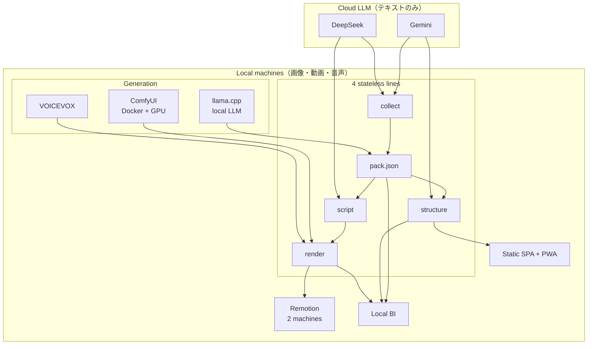

# AI Production Line

**重い生成はローカル、軽い推論はクラウド。処理ごとに置き場所を選ぶ制作基盤。**

ComfyUI（Docker）による画像・動画生成、音声合成、レンダリング、配信レイヤ、
運用ダッシュボードを**1つのリポジトリ**にまとめた個人開発です。
画像・動画・音声の生成は外部APIを使わず、すべて手元のGPUで完結します。
一方でテキスト生成は、品質とコストのバランスからクラウドLLMも併用しています。

[](https://github.com/RintaroMatsumoto/ai-production-line/actions/workflows/ci.yml)
[](https://www.python.org/)
[](requirements.txt)
[](LICENSE)

[English README](README.en.md) · [アーキテクチャ](docs/01-architecture.md) · [生成基盤](docs/03-video-pipeline.md) · [配信レイヤ](docs/07-website.md) · [BI](docs/08-bi-dashboard.md) · [会話記憶RAG](docs/09-conversation-memory-rag.md) · [実測値](docs/05-benchmarks.md)

> **作った人**：松本 倫太郎。陸上自衛隊で22年間、通信インフラと戦闘シミュレーションシステムの開発に従事。IT実務24年。

## 処理の置き場所

「全部ローカル」でも「全部クラウド」でもありません。**特性で分けています。**

| 処理 | 実行場所 | 理由 |
|---|---|---|
| 画像生成 | **ローカル**（ComfyUI / Docker） | 試行回数が多く、従量課金だと費用が読めない |
| 動画生成 | **ローカル** | 同上。素材を外に出さずに済む |
| LoRA学習 | **ローカル** | モデルとデータが大きく、転送が現実的でない |
| 音声合成 | **ローカル**（VOICEVOX） | 低遅延・無料・オフラインで動く |
| 映像合成 | **ローカル**（Remotion） | 素材の受け渡しがボトルネックになる |
| テキスト生成（設計・執筆） | **クラウドLLM** | 12GBのGPUでは品質が届かない。判断の質が成果物を決める |
| テキスト生成（大量の下処理） | **クラウドLLM（安価）** | 単価重視。ローカルで回すより速く安い |
| ローカルLLM | **ローカル**（llama.cpp） | 機密性の高い処理と、外部障害時の代替系として保持 |
| 配信 | 静的ホスティング | サーバー運用を持たないため |
| 素材収集 | 外部ソース | 一次情報を取りに行く必要がある |

**生成のコストが支配的な部分をローカルに置く**のが、この構成の要点です。
テキストは回数が限られ、品質がそのまま成果物の質になるため、クラウドの上位モデルに任せています。

## スタック

| 層 | 技術 |
|---|---|
| 画像・動画生成 | **ComfyUI（Docker / ai-dock base）**、SDXL、Flux、Wan 2.2、AnimateDiff |
| 一貫性 | LoRA（kohya_ss）、IP-Adapter FaceID、ControlNet、ReActor |
| 後処理 | Real-ESRGAN、RIFE フレーム補間、LivePortrait / SadTalker / Wav2Lip |
| LLM（ローカル） | llama.cpp（125B MoE / 256K context / 12GB VRAM） |
| LLM（クラウド） | Gemini、DeepSeek（テキスト生成・下処理） |
| 音声 | VOICEVOX（ローカルHTTP） |
| 映像合成 | Remotion（React → MP4） |
| オーケストレーション | Python（標準ライブラリのみ） |
| 配信 | 静的SPA＋PWA（Cloudflare Pages、サーバー不要） |
| 可視化 | ローカルBI（Python標準ライブラリ、Chart.js同梱） |
| 実行基盤 | Docker + GPUパススルー、Windows 11 |

## 数字（実測）

| 項目 | 値 | 環境 |
|---|---|---|
| 画像生成 | **約4秒/枚** | RTX 3080 10GB / SDXL |
| 画像生成 | 約12秒/枚 | RTX 3060 12GB / SDXL |
| 動画生成 | **約5秒/クリップ** | RTX 3080 / Wan 2.2 TI2V 5B / 832×480 |
| 動画生成 | 約10秒/クリップ | RTX 3060 / 同モデル |
| LoRA訓練 | 2.40 s/it | RTX 3060 / SDXL / kohya_ss |
| ローカルLLM推論 | 10.8 t/s @ 256K context | RTX 3060 / 125B MoE |
| 映像レンダ | 2台並列（concurrency 4 / 6） | Remotion |
| 画像・動画・音声の外部API | **0** | すべてローカル |

## 3つの技術的ハイライト

### 1. ComfyUIをDockerで運用する

生成基盤はDockerイメージに閉じ込めています。ホストを汚さず、2台のマシンで同じ環境を再現できます。

```yaml
services:
  comfyui:
    build: .
    image: ghcr.io/ai-dock/comfyui:custom
    ports: ["18188:18188"]
    environment:
      - COMFYUI_ARGS=--listen 0.0.0.0 --port 18188 --lowvram --force-fp16
      - NVIDIA_VISIBLE_DEVICES=all
    volumes:
      - comfyui_models:/opt/ComfyUI/models
      - comfyui_custom_nodes:/opt/ComfyUI/custom_nodes
      - comfyui_output:/opt/ComfyUI/output
    deploy:
      resources:
        reservations:
          devices:
            - driver: nvidia
              count: 1
              capabilities: [gpu]
```

- ai-dock の ComfyUI イメージをベースに、カスタムノードの依存を固定
- **Triton + SageAttention** を導入し、推論を20〜30%高速化
- モデル・custom_nodes・output は named volume に分離（イメージ再ビルドで消えない）
- `--lowvram --force-fp16` で10〜12GBのVRAMに収める

同じイメージを2台に配布し、VRAMに応じてワークフローを切り替えます。

### 2. 生成を「ライン」として回す

画像1枚を作る作業を、再現可能なバッチに分解しています。

```bash
py パイプライン/line1_collect/batch_collect.py --limit 10
py パイプライン/line2_material/watch_material.py
py パイプライン/line3_script/watch_script.py
py パイプライン/line4_video/watch_video.py --machine m1
```

```
[Line 1: 収集・蒸留] → pack.json
        ├→ [Line 2: 構造化] → text.json / test.json / figures → 自動デプロイ
        └→ [Line 3: 台本]   → script.md
                              └→ [Line 4: 映像] → 音声・演出・レンダ
```

**状態を持ちません。** 進捗はファイルの有無で決まり、キューもワーカーも状態機械もありません。
失敗したユニットはログを残してスキップし、ラインは止まりません。

### 3. 生成から配信・観測まで一気通貫

- **配信**：生成物を静的SPA＋PWAとして配信。DBもAPIもサーバーも不要
- **観測**：1コマンドで起動するローカルBI。工程別の進捗、稼働状況、コスト、失敗を1画面に集約
- **再現性**：Dockerイメージ・要件固定・ボリューム分離で、別マシンでも同じ結果

## 関連プロジェクト：会話記憶RAG

この制作基盤とは別に、日々の開発セッションを索引して「前回の続き」から再開するローカルRAGを個人開発で運用しています。

検索は SQLite FTS5（日本語bigram）と multilingual-e5-small（384次元・float16）の2レーンに、直近セッションを加えた3レーンを RRF で統合。チャンクは700文字・100文字オーバーラップ、SHA-256で重複排除、秘密情報はマスク、注入は1回・最大3,500文字に制限しています。

| 項目 | 値 |
|---|---:|
| 索引セッション | 254 |
| チャンク | 30,198 |
| 索引DB | 259.8 MB |
| 増分索引 | 15分ごと |

詳細は [docs/09-conversation-memory-rag.md](docs/09-conversation-memory-rag.md)。

## アーキテクチャ



詳細は [docs/01-architecture.md](docs/01-architecture.md)。

## リポジトリ構成

```
.
├── docs/
│   ├── 01-architecture.md      処理の置き場所と4ライン
│   ├── 02-local-llm.md         ローカルLLM（量子化・KV・スループット）
│   ├── 03-video-pipeline.md    ComfyUI / Wan 2.2 / LoRA / レンダ
│   ├── 04-quality-gates.md     機械チェックとライセンスガード
│   ├── 05-benchmarks.md        実測値
│   ├── 06-lessons.md           失敗と対策
│   ├── 07-website.md           配信レイヤ（SPA + PWA）
│   ├── 08-bi-dashboard.md      ローカルBI
│   └── 09-conversation-memory-rag.md  会話記憶RAG（設計・数値・制約）
├── src/
│   ├── pipeline/
│   │   ├── lines.py            ステートレスなライン実行
│   │   ├── progress.py         ファイル有無からの進捗計算
│   │   ├── distribute.py       フレーム分割の配分計画
│   │   └── gates/              音声鮮度・レイアウト検査
│   └── llm/                    ベンチマーク・ヘルスチェック
├── samples/                    設定例・デモデータ
└── tests/                      unittest（45件・外部依存なし）
```

## クイックスタート

実行時依存はありません（Python標準ライブラリのみ）。

```bash
python -m src.pipeline.lines --root samples/lessons --line line2 --dry-run
python -m src.pipeline.progress --root samples/lessons

python samples/make_demo_audio.py
python -m src.pipeline.gates.audio_freshness \
  --scenes samples/scenes.example.json --audio-dir samples/audio
python -m src.pipeline.gates.visual_layout samples/layout.example.json

python -m unittest discover -s tests -v
```

> `python` が使えない環境では `py` に読み替えてください。

## この公開版について

個人プロジェクトの**公開用エディション**です。

含めていないもの：モデルファイル・LoRA、素材、生成物、認証情報、内部ホスト名、
実運用のプロンプト全文、キャラクター設定、会話記憶RAGの実装本体（設計と数値のみ `docs/09` に収録）。

含めているもの：設計判断、Docker構成、一般化した実装、実測値、失敗の記録。

## ライセンス

コードは [MIT](LICENSE)。ドキュメントは CC BY 4.0。

---

**Author** — 松本 倫太郎 / Rintaro Matsumoto
陸上自衛隊で22年間、通信インフラと戦闘シミュレーションシステムの開発に従事。
現在はローカルGPUによる生成メディア基盤の設計・運用に取り組んでいます。
