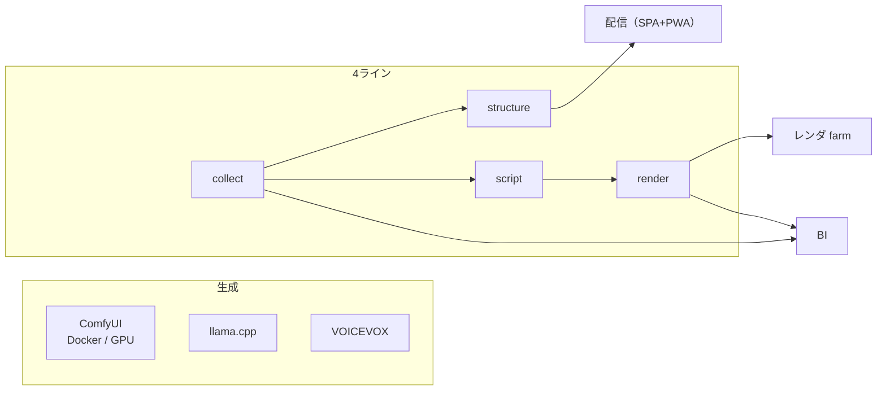

# 01. アーキテクチャ

## 設計原則

1. **ローカル完結** — 生成・推論・合成を、すべて手元のGPUで行う
2. **状態を持たない** — 進捗はファイルの有無。プロセスに状態を置かない
3. **ラインを独立させる** — 1本が止まっても、他は進む
4. **失敗はスキップ** — エラーで全体を止めない
5. **再現できる形で配る** — 環境はDocker、依存は固定、出力はボリューム分離

## 全体像



| 層 | 役割 | 実行単位 |
|---|---|---|
| 生成 | 画像・動画・音声・テキスト | ジョブ |
| ライン | 収集 → 構造化 → 台本 → 映像 | ユニット |
| 配信 | 生成物を静的サイトとして配信 | デプロイ |
| 観測 | 進捗・稼働・コスト・失敗 | スナップショット |

## なぜDockerなのか

生成系は依存が壊れやすい領域です。PyTorch・CUDA・custom_nodes・モデルの組み合わせが
1つずれるだけで動かなくなります。それを2台のマシンで揃えるのは、手作業では続きません。

- ベースイメージを固定し、追加依存は `requirements.txt` でピン留め
- モデル・custom_nodes・output は named volume（イメージ再ビルドで消えない）
- GPUは `deploy.resources.reservations.devices` でパススルー
- VRAMに応じて起動引数だけ変える（`--lowvram --force-fp16`）

**環境の再現を、イメージ1つに寄せています。**

## なぜ「状態を持たない」のか

前バージョンは、常駐ワーカー・独自キュー・承認台帳・状態機械で進捗を管理していました。
流量が増えると、

- キューが詰まる
- 状態と実ファイルがズレる
- 障害時に「どこまで進んだか」の復元コストが大きい
- 1件の失敗が全体を止める

という問題が支配的になります。**管理する状態そのものが故障点**でした。

現行版は、状態をファイルシステムに逃がしました。

```python
def is_done(unit_dir: Path, line: str) -> bool:
    return all((unit_dir / name).exists() for name in OUTPUTS[line])
```

| 問い | 答え方 |
|---|---|
| このユニットは終わったか | 出力ファイルがあるか |
| 次は何をすればいいか | 未処理を若い番号から再スキャン |
| 途中で落ちたら | 再実行すれば未処理から再開 |
| やり直したい | `--force` で対象だけ上書き |

進捗の正がファイルなので、BIはパイプラインを変更せずに読むだけで済みます。

## 処理順

原則として、グループ内の `#01` から順に処理します。

```python
def sort_key(unit_id: str) -> tuple:
    # V3-X-C01-S01-L10 を L02 より後に並べる（数値比較）
    ...
```

上流未完了などで飛ばしたユニットがあっても、準備ができ次第**常に最も若い番号に戻る**。

これは見た目の問題ではありません。順序が崩れると、
前提が揃っていない生成物が先に配信され、後から整合を取る作業が発生します。

## 失敗の扱い

```python
try:
    run_one(unit)
except Exception as exc:
    log_error(unit, exc)      # 記録して
    skipped.append(unit)      # 次へ
    continue                  # ラインは止めない
```

- 失敗は**そのユニットだけ**
- リトライは**最大1回**
- 成功したユニットは `--force` なしでは触らない

「1件の失敗で全停止」は安全に見えますが、大規模に回すと
1件の異常で毎回止まる方が危険です。**止まらないこと**を優先しています。

## 品質の作り方

検査を増やすのではなく、**上流の質**で下流を守ります。

| 層 | 手段 |
|---|---|
| 入力 | 一次資料で範囲を確定する |
| 設計 | 良質なサンプルをプロンプトに同梱する |
| 生成 | 1発で狙う。モデルは用途で分担 |
| 検査 | 機械チェック（構文・ファイル・計算・破損）＋最大1回リトライ |
| 人間 | 新しい種類の最初の数件と、公開判断だけ |

## モデルの分担

| 用途 | モデル |
|---|---|
| 判断・設計・執筆 | Gemini 4 Hydrogen |
| 定型・大量下処理 | DeepSeek V4.1 Flash |
| 画像・動画 | SDXL / Flux / Wan 2.2（ComfyUI） |
| 音声 | VOICEVOX |

コストの大半は下処理なので、そこを安いモデルに寄せています。
ただし**生成そのものはローカル**に置くことで、試行回数のコストを切り離しています。

## 成果物の配置

```
<group>/<unit>/
├── pack.json          収集・蒸留の結果
├── media/             素材
├── figures/           図版
├── text.json          構造化データ
├── test.json          検証データ
├── script.md          台本
├── scenes.json        演出タイムライン
├── audio/             音声
├── video.mp4          映像
└── status.json        生成モデル・プロンプト版・公開ID
```

**1ユニット＝1フォルダ**。知りたいことは、そのフォルダを開けば全部あります。

## 観測性

パイプライン本体には監視を持たせず、**外から読む**形にしました。

- BIはスナップショットをキャッシュして生成
- プロセス検出もキャッシュ
- 稼働判定は「実行中プロセスのコマンドライン」＋「最終成果物の更新時刻」
- 停滞の閾値はラインごとに設定

監視をパイプラインに埋め込むと、監視のバグが本番を止めます。
読み取り専用の外部ツールにしたことで、BIが落ちても制作は止まりません。
