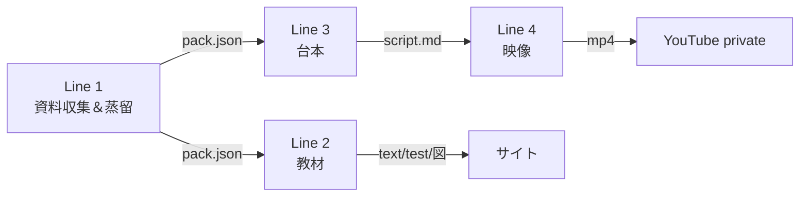

# 01. アーキテクチャ

## 設計原則

1. **状態を持たない** — 進捗はファイルの有無。プロセスに状態を置かない
2. **ラインを独立させる** — 1本が止まっても、他は進む
3. **失敗はスキップ** — エラーで全体を止めない。ログを残して次へ
4. **上流の質で下流を守る** — 査読を増やすより、入力と設計を良くする
5. **人間は例外だけ見る** — 定常作業は全自動、判断は公開時だけ

## 4つのライン



| ライン | 入力 | 出力 | 実行単位 |
|---|---|---|---|
| Line 1 | 外部ソース（Web・字幕・PDF・画像） | `pack.json` | コマ |
| Line 2 | `pack.json` | `text.json` / `test.json` / `figures/` | コマ |
| Line 3 | `pack.json` | `script.md` | コマ |
| Line 4 | `script.md` / `pack.json` | `scenes.json` / `audio/` / `video.mp4` | コマ |

Line 1 の出力が Line 2 と Line 3 の**共通入力**になるため、調査は1回で済みます。
V2では教材チームと映像チームが別々に調査しており、同じ単元を2回調べていました。

## なぜ「状態を持たない」のか

前バージョンは、常駐ワーカー・独自キュー・承認台帳・状態機械・多段査読で
品質と進捗を管理していました。しかし流量が増えると、

- キューが詰まる
- 状態機械と実ファイルがズレる
- 障害時に「どこまで進んだか」を復元するコストが大きい
- 1コマの失敗がライン全体を止める

という問題が支配的になります。**管理する状態そのものが故障点**でした。

現行版は、状態をファイルシステムに逃がしました。

```python
def is_done(lesson_dir: Path, line: str) -> bool:
    return all((lesson_dir / name).exists() for name in OUTPUTS[line])
```

| 問い | 答え方 |
|---|---|
| このコマは終わったか | 出力ファイルがあるか |
| 次は何をすればいいか | 未処理を若い番号から再スキャン |
| 途中で落ちたら | 再実行すれば未処理から再開 |
| やり直したい | `--force` で対象コマだけ削除→再生成 |

進捗の正がファイルなので、**BIはパイプラインを一切変更せずに読むだけ**で済みます。
実際、BIは読み取り専用で、パイプラインの再起動も修正もデプロイもしません。

## 処理順

原則として、科目内の `#01` から順に作ります。

```python
# 優先順は「科目 → 章 → 節 → コマ」の番号順
def sort_key(lesson_id: str) -> tuple:
    ...
```

上流未完了などで飛ばしたコマがあっても、準備ができ次第**常に最も若い番号に戻る**。
Line 4 は1コマ完了ごとに未処理リストを再スキャンします。

これがないと、「後から作った応用編」だけが先に公開され、
学習者が前提知識なしで開くことになります。

## 失敗の扱い

```python
try:
    run_one(lesson)
except Exception as exc:
    log_error(lesson, exc)      # エラーログを残す
    skipped.append(lesson)      # 記録して
    continue                    # ラインは止めない
```

- 失敗は**そのコマだけ**。全体を止めない
- リトライは**最大1回**。無限ループにしない
- 成功したコマは二度と触らない（`--force` を除く）

「1件の失敗で全停止」は安全に見えますが、1,146コマを回すと
1件の異常で毎回止まる方が危険です。**止まらないこと**を優先しています。

## 品質の作り方

査読を何重にも重ねるのではなく、**上流の質**で下流を守ります。

| 層 | 手段 |
|---|---|
| 入力 | 公式PDF（学習指導要領・シラバス）で範囲を確定 |
| 設計 | 黄金サンプル（お手本のコマ）をプロンプトに同梱 |
| 生成 | 1発で90点を狙う。モデルは用途で分担 |
| 検査 | 機械チェック（構文・ファイル有無・計算・無音）＋最大1回リトライ |
| 人間 | 新科目の最初の1〜2コマと、YouTube公開判断だけ |

## モデルの分担

| 用途 | モデル |
|---|---|
| 判断・設計・執筆（カリキュラム、台本、教材、演出） | Gemini 4 Hydrogen |
| 定型・大量下処理（収集データの整形、読み処理） | DeepSeek V4.1 Flash |

コストの大半は下処理なので、ここを安いモデルに寄せています。

## 成果物の配置

```
授業/<科目ID>/<コマID>/
├── pack.json          Line 1
├── media/             Line 1（写真・図の素材）
├── figures/           Line 2
├── text.json          Line 2
├── test.json          Line 2
├── script.md          Line 3
├── scenes.json        Line 4
├── audio/             Line 4
├── video.mp4          Line 4
└── status.json        生成モデル・プロンプト版・YouTube ID
```

**1コマ＝1フォルダ**。あるコマについて知りたいことは、そのフォルダを開けば全部あります。

## 観測性

パイプライン本体には監視を持たせず、**外から読む**形にしました。

- BIは8秒キャッシュでスナップショットを生成
- プロセス検出は15秒キャッシュ
- ラインの稼働判定は「実行中プロセスのコマンドライン」＋「最終成果物の更新時刻」
- 停滞の閾値はラインごとに設定（収集15分、教材・台本25分、映像45分）

監視をパイプラインに埋め込むと、監視のバグが本番を止めます。
読み取り専用の外部ツールにしたことで、BIが落ちても制作は止まりません。
