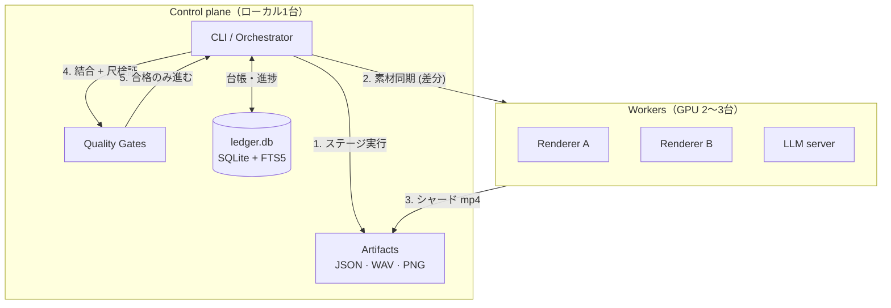

# 01. アーキテクチャ

## 設計原則

このパイプラインは、次の4つの原則で組み立てています。

1. **成果物を契約にする** — ステージ間はファイル（JSON/WAV/PNG/MP4）だけで受け渡す
2. **再開可能性を最優先する** — どのステージからでも再実行できる
3. **「成功したように見える失敗」を機械で止める** — ゲートを通過しない限り次へ進めない
4. **制御と実行を分離する** — 司令塔は1台、重い処理は複数台

## 全体構成



### なぜ「制御」と「実行」を分けるのか

レンダリングはCPU/GPUを100%使い、数分〜数十分かかります。台本生成やQAは数秒です。
同居させると、重い処理が軽い処理を待たせて全体が止まります。

分離した結果、**ローカルは制作とQAに専念し、レンダだけをワーカーに投げる**形になりました。
結果として、2台構成で1本あたり15.7分、3台構成で11.2分まで短縮しています。

## 成果物を契約にする

各ステージは「入力ファイル」と「出力ファイル」を宣言し、それ以外を知りません。

| ステージ | 入力 | 出力 |
|---|---|---|
| `script` | 単元定義・素材カード | 台本 JSON |
| `scene` | 台本 JSON | シーン JSON（時刻・話者・字幕） |
| `visuals` | シーン JSON | SVG 図解 + 配置情報 |
| `audio` | シーン JSON + 読み辞書 | WAV + 指紋ファイル `.fp` |
| `render` | シーン JSON + 素材 | MP4 |
| `qa` | MP4 + 全成果物 | 判定 JSON |

この形にすると、**途中のステージだけ差し替えられます**。
例えばTTSエンジンをVOICEVOXから別のものに変えても、`audio` ステージの出力仕様さえ守れば他は無傷です。

## 再開可能性

`--from` / `--to` でステージ範囲を指定できます。

```bash
python -m pipeline.orchestrator --unit U-M-I-02 --from audio   # 音声から先だけ
python -m pipeline.orchestrator --unit U-M-I-02 --to script    # 台本まで
```

さらに、出力ファイルが入力より新しい場合はスキップします（mtimeベース）。
これがないと、1回の修正に毎回20分かかります。

### 落とし穴：スキップは「古い成功」を温存する

再開可能性は強力ですが、**古い成果物を「最新」と誤認する**危険と隣り合わせです。
mtimeだけでは、依存関係の変更（読み辞書の修正など）を検出できません。

これを埋めるのが、後述する**指紋ベースのゲート**です。

## 台帳（ledger.db）

単元・素材・進捗・QA結果を1つのSQLiteに集約しています。

- **FTS5** による全文検索で、11,669ページの資料から根拠を引く
- 進捗は**ローカル一元管理**（ワーカーからは書き込まない）
- 約48MB。バイナリを git 管理から外し、再生成可能にしている

台帳を分離した理由は、**「どの単元がどこまで進んだか」をファイル名から判断しないため**です。
ファイル名ベースの進捗管理は、途中で命名規則が変わると破綻します。

## エラーの扱い

終了コードを意味別に分けています。

| コード | 意味 | 動作 |
|---|---|---|
| 0 | 成功 | 次へ |
| 1 | 失敗 | 停止 |
| 2 | 引数エラー | 停止（使い方表示） |
| 3 | **ゲート不合格** | 停止（修正方法を表示） |

`3` を分けているのが重要で、**「壊れた」のと「基準に達していない」は対処が違う**からです。
前者はバグ調査、後者はコンテンツ修正です。ログを見た瞬間にどちらか分かるようにしています。

## 観測性

- 各ステージの標準出力をログファイルに保存
- 失敗時は「次に実行すべきコマンド」をメッセージに含める

```
[ng] 尺が実測と乖離=再シーン後の audio 再実行漏れ
     → python -m pipeline.orchestrator --unit U-M-I-02 --from audio
```

自動化で本当に時間を食うのは、失敗そのものではなく**「何が起きたか分からない時間」**です。
エラーメッセージに復旧手順を埋め込むことで、半年後の自分でも復旧できます。
