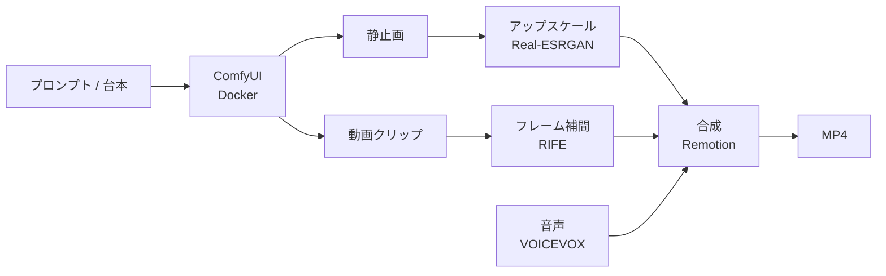
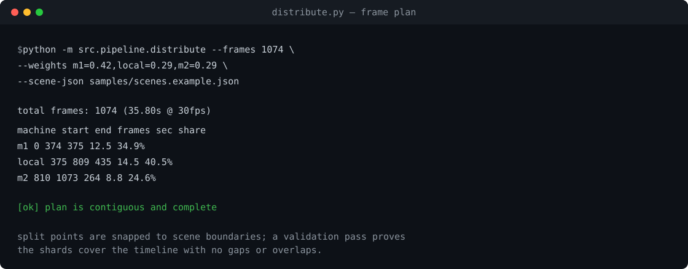

# 03. 生成パイプライン（画像・動画）

ComfyUI（Docker）を中心に、**画像生成から映像合成までをローカルで完結**させます。
テキスト（プロンプトや台本のもと）はクラウドLLMで生成し、そこから先をローカルに持ち込みます。

## 構成



## ComfyUI を Docker で動かす

```dockerfile
FROM ghcr.io/ai-dock/comfyui:latest

COPY requirements.txt /tmp/requirements.txt
RUN /opt/environments/python/comfyui/bin/pip install --no-cache-dir -r /tmp/requirements.txt

# 推論アクセラレーション
RUN /opt/environments/python/comfyui/bin/pip install --no-cache-dir triton-windows==3.3.1.post19

RUN apt-get update && apt-get install -y --no-install-recommends \
    ffmpeg libgl1-mesa-glx libglib2.0-0 libsm6 libxext6 libxrender-dev libgomp1
```

```yaml
services:
  comfyui:
    build: .
    image: ghcr.io/ai-dock/comfyui:custom
    restart: unless-stopped
    ports: ["18188:18188"]
    environment:
      - COMFYUI_ARGS=--listen 0.0.0.0 --port 18188 --lowvram --force-fp16
      - NVIDIA_VISIBLE_DEVICES=all
    volumes:
      - comfyui_custom_nodes:/opt/ComfyUI/custom_nodes
      - comfyui_models:/opt/ComfyUI/models
      - comfyui_output:/opt/ComfyUI/output
      - comfyui_input:/opt/ComfyUI/input
    deploy:
      resources:
        reservations:
          devices:
            - driver: nvidia
              count: 1
              capabilities: [gpu]
```

### 設計上の判断

| 判断 | 理由 |
|---|---|
| ベースは ai-dock | CUDA・PyTorch・ComfyUIの整合が取れた状態で配布されている |
| named volume で分離 | イメージを再ビルドしてもモデルとcustom_nodesが残る |
| 依存をピン留め | custom_nodes は互いのバージョンに敏感 |
| Triton + SageAttention | attention の実装を差し替えて20〜30%高速化 |
| `--lowvram --force-fp16` | 10〜12GBのVRAMに収める |

モデルはイメージに含めません。**コードと重みを分離**することで、
イメージサイズを抑え、モデルの差し替えを再ビルドなしで行えます。

## 生成できるもの

| 種類 | モデル / 手法 |
|---|---|
| 静止画 | SDXL（RealVisXL / Illustrious）、Flux（GGUF量子化） |
| 動画 | Wan 2.2 TI2V 5B、AnimateDiff Lightning |
| 一貫性 | LoRA（kohya_ss）、IP-Adapter FaceID、ControlNet |
| 顔の差し替え | ReActor（inswapper） |
| リップシンク | LivePortrait / SadTalker / Wav2Lip |
| 高解像度化 | Real-ESRGAN 4x |
| 滑らか化 | RIFE VFI |

同じイメージを2台に配り、VRAMに応じてワークフローを切り替えます。

| マシン | VRAM | 画像 | 動画（832×480） |
|---|---|---|---|
| M1（RTX 3060） | 12GB | 約12秒/枚 | 約10秒/クリップ |
| M2（RTX 3080） | 10GB | 約4秒/枚 | 約5秒/クリップ |

## LoRA

被写体の一貫性は、プロンプトでは安定しません。LoRAで寄せます。

- データセットのキャプショニング（JoyCaption + WD14 のハイブリッド）
- kohya_ss でSDXL LoRAを訓練（実測 2.40 s/it）
- 学習率・epochは固定せず、評価画像で選ぶ
- 推論時は LoRA + IP-Adapter の併用で、構図と顔を分離して制御

VRAMが10GBのマシンでは `batch_size=1` に落として回します。

## 映像の組み立て

生成したクリップは、そのままでは尺も音も揃いません。

1. 音声（VOICEVOX）を先に確定し、**実測尺**を取る
2. 尺に合わせてシーンを配置（`scenes.json`）
3. Remotion で図・字幕・トランジションを合成
4. 2台のマシンで並列レンダ（concurrency 4 / 6）
5. 尺と継ぎ目を検証

音声の尺を正にすることで、文字数からの見積もりが不要になります。

## 分散レンダ

前バージョンでは、1本の動画をフレーム範囲で分割して複数マシンに投げていました。
実装は `src/pipeline/distribute.py` に残しています。

- 分割点は**シーン境界にスナップ**（セリフの途中で切らない）
- 配分は実測スループット比で重み付け
- 結合後に**尺を検証**（±0.2秒）
- 継ぎ目16フレームのMD5がマシン間で一致

現行版はユニット単位でマシンを割り当てるため常時は不要ですが、
長尺や急ぎの案件では同じロジックを使います。



## 失敗と対策

| 症状 | 対策 |
|---|---|
| 生成が落ちる | ユニット単位でスキップし、他は継続 |
| VRAM不足 | 解像度・バッチ・量子化を落として再試行 |
| 音声と台本がズレる | 実測尺を正として演出を再生成 |
| 図が見切れる | 描画後のbboxを検査 |
| 古い音声が混入する | 指紋ファイルと突合 |
| ディスク不足 | レンダ前に空き容量を確認、不足なら除外 |

詳細は [04-quality-gates.md](04-quality-gates.md)。
