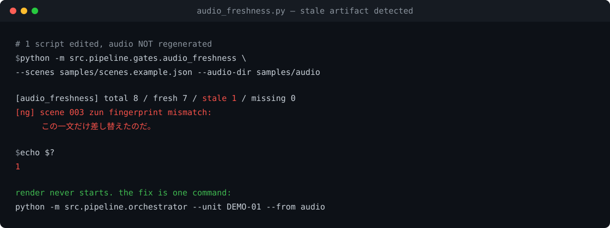

# 04. 品質チェックとライセンスガード

## 方針

検査を増やすほど品質が上がるわけではありません。
**上流を固め、機械で判定できるものだけを機械に見せます。**

| 層 | やること |
|---|---|
| 入力 | 一次資料で範囲を確定する |
| 設計 | 良質なサンプルをプロンプトに同梱する |
| 生成 | 1発で狙う。ダメなら**1回だけ**リトライ |
| 検査 | 構文・ファイル・計算・破損・レイアウト |
| 人間 | 新しい種類の最初の数件と、公開判断 |

## 機械チェック

| 対象 | 検査 |
|---|---|
| JSON | スキーマ・必須キー・型 |
| 構造化データ | 見出し構造、空セクション、文字数 |
| 検証データ | 正答が選択肢に存在するか、解説の有無 |
| 台本 | 話者の偏り、1文の長さ、禁止表現 |
| 図 | 描画後のbbox（見切れ・中央ズレ） |
| 音声 | 無音区間、破損、尺の一致 |
| 動画 | 尺、フレーム取得、黒画面 |

失敗したら**1回だけ**リトライし、それでもダメならログを残してスキップします。

## ライセンスガード

外部から素材を取る場合、権利処理を自動化に組み込みます。

### 1. ホワイトリスト

利用可能な素材は次のいずれかに限定します。

- Public Domain
- CC0
- CC BY
- 政府標準利用規約

`CC BY-SA` / `NC` / `ND` は**自動除外**します。
メタデータの名称とURLの両面で判定し、条件を満たさないものは候補に入れません。

### 2. 表現のコピー検出

外部の文章をそのまま下流に渡しません。
手順・構造・要点へ変換したうえで、元テキストとの**連続15文字以上の完全一致**を検査します
（一般用語・固有名詞は除外）。

```python
def longest_common_substring(a: str, b: str) -> int:
    ...
# 15文字以上で NG
```

### 3. キャッシュの破棄

取得した生データは一定期間で自動パージします。
保持し続けること自体がリスクになるためです。

## 具体例：音声鮮度ゲート

自動化で最も怖いのは、失敗ではなく**「成功したように見える古い出力」**です。

読み辞書を直したのに音声を再生成せずレンダした結果、
すべてのWAVが旧辞書のまま動画に残った事故がありました。
レンダは成功し、終了コードは0でした。

対策として、シーン・辞書・合成パラメータから**指紋（SHA256）**を計算し、
実在するWAVの指紋と突合します。

```python
def fingerprint(text, speaker, params):
    payload = json.dumps(
        {"text": text, "speaker": speaker, "params": params},
        ensure_ascii=False, sort_keys=True,
    )
    return hashlib.sha256(payload.encode("utf-8")).hexdigest()
```

| 状態 | 意味 |
|---|---|
| fresh | 一致 |
| stale | 不一致（古い） |
| missing | ファイルがない |

1件でも stale / missing があれば**レンダ前に停止**します。
設定ではなく**実ファイル**を見るのがポイントです。

## 具体例：レイアウトゲート

テキスト幅はフォント依存で、生成時には確定しません。
そのため**実際に描画したバウンディングボックス**を取得して判定します。

| 検査 | 基準 |
|---|---|
| 中央ズレ | ±12px 以内 |
| 見切れ | キャンバス外に要素がない |
| 図なしシーン | 0件 |

## ゲートの設計原則

1. **実物を見る** — 設定ではなく生成物を検証する
2. **復旧手順を出す** — 「NG」だけでは動けない
3. **終了コードを分ける** — 失敗(1)とゲート不合格(3)は対処が違う
4. **レポートを残す** — 判定理由をMarkdownで出力する

```bash
$ python -m src.pipeline.gates.audio_freshness \
    --scenes samples/scenes.example.json --audio-dir samples/audio
[audio_freshness] total 8 / fresh 7 / stale 1 / missing 0
  [ng] scene 003 a fingerprint mismatch: この一文だけ差し替えたのだ。
```



再生成は1コマンドです。
