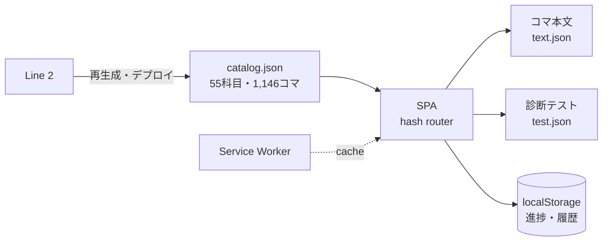

# 07. ウェブサイト

1,146コマの教材を配信する、ログイン不要の静的SPA＋PWAです。

## なぜ静的サイトなのか

| 方式 | 判断 |
|---|---|
| サーバー＋DB | ✕ 運用コスト、障害対応、個人情報の管理が発生する |
| 静的ホスティング | ○ 落ちない、安い、速い、個人情報を持たない |

学習履歴は**端末の `localStorage` にしか保存しません**。
ログインもアカウントも作らないため、漏えいする個人情報がそもそも存在しません。

## 構成



```
サイト/
├── index.html            シェル（SVGスプライト・ナビ・フッター）
├── manifest.webmanifest  PWA
├── sw.js                 Service Worker
├── assets/
│   ├── app.js            ルーティング・描画・進捗（約1,800行）
│   ├── style.css         基本レイアウト
│   ├── textbook.css      参考書ビュー
│   └── v3.css            コンポーネント
└── data/catalog.json     55科目・1,146コマの目次（約620KB）
```

ビルド工程はありません。`catalog.json` を差し替えてアップロードするだけです。

## ルーティング

ハッシュベースのSPAです。サーバー側のrewrite設定が不要なので、
Cloudflare Pages でも `file://` でも同じように動きます。

| ルート | 画面 |
|---|---|
| `#/` | ホーム（区分別の進捗、続きから） |
| `#/courses` | 科目一覧 |
| `#/subject/<科目ID>` | 章・節・コマの一覧 |
| `#/lesson/<コマID>` | 参考書ビュー／診断テスト |
| `#/progress` | 通知表（学習履歴・連続日数） |
| `#/shop` | ショップ |

## 参考書ビュー

1コマは「授業1時間分」を想定し、テキスト10〜15分・テスト10問で構成します。


- 2人のキャラクターの**掛け合い**で本文が進む
- 節ごとのタブ、章の目次、前後のコマへの移動
- **赤シートモード**：重要語を隠して自己テスト
- 数式は KaTeX で描画（`auto-render`）
- 図解は静止SVG。動画に依存せず読める

## 進捗とゲーミフィケーション

| 仕組み | 内容 |
|---|---|
| 通知表 | 読了・テスト正答率・連続学習日数 |
| 学習ポイント | 学習で貯まるポイント。部屋のアイテムと交換 |
| 部屋 | キャラクター別に独立した模様替え |
| 実績 | 「3回合格」「5コマ読了」などで解放 |

`localStorage` のキーはバージョン付きで分離しています。

```
app.v3.progress.v1   読了・正答
app.v3.wallet.v1     ポイント
app.v3.room.v1       部屋の状態
app.v3.streak.v1     連続日数
```

## PWA / オフライン

`sw.js` はコアシェル（HTML・CSS・JS・フォント・キャラクター画像・`catalog.json`）を
インストール時にキャッシュします。

- ネットワーク優先、失敗したらキャッシュ
- 教材本文は初回閲覧時にキャッシュ
- ホーム画面に追加でき、アプリのように起動

通学中に電波が不安定でも、開いたことのあるコマは読めます。

## テーマ

緑／桃の2テーマ。`<html data-theme>` を切り替えるだけで、
CSS変数が一括で変わります。選択は `localStorage` に保存され、
**HTMLの描画前に適用**してちらつきを防いでいます。

```html
<script>
  const theme = localStorage.getItem("app.theme") === "metan" ? "metan" : "zunda";
  document.documentElement.dataset.theme = theme;
</script>
```

## 自動デプロイ

Line 2 が `text.json` / `test.json` を生成すると、

1. `catalog.json` を再構築（公開済みフラグを立てる）
2. Cloudflare Pages へアップロード
3. サイトの「サイト公開」指標が更新される

人間の確認は、新科目の最初の1〜2コマだけです。
それ以降は全自動でデプロイされます。

## 表示速度

| 指標 | 値 |
|---|---|
| `catalog.json` | 約620KB（55科目・1,146コマ） |
| 初回表示 | シェル＋カタログのみ |
| 本文 | コマ単位で遅延取得 |
| フォント | M PLUS Rounded 1c を4ウェイト、`woff2` |
| 画像 | WebP |

カタログを1ファイルにしているのは、**検索と一覧をクライアント側で完結**させるためです。
APIラウンドトリップなしで、キーワード検索と絞り込みが動きます。
