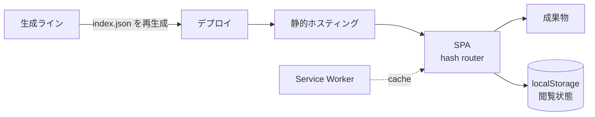

# 07. 配信レイヤ（SPA + PWA）

生成物を配るための、サーバーを持たない配信レイヤです。

## なぜ静的配信なのか

| 方式 | 判断 |
|---|---|
| サーバー＋DB | ✕ 運用・障害対応・個人情報の管理が発生する |
| 静的ホスティング | ○ 落ちない、安い、速い、個人情報を持たない |

生成はローカル、配信は静的。**書き込みと読み取りを完全に分離**しています。
配信側が落ちても生成は続き、生成が止まっても配信は続きます。

## 構成



```
site/
├── index.html            シェル
├── manifest.webmanifest  PWA
├── sw.js                 Service Worker
├── assets/
│   ├── app.js            ルーティング・描画
│   ├── style.css         基本レイアウト
│   └── components.css    コンポーネント
└── data/index.json       目次（生成物の一覧）
```

ビルド工程はありません。`index.json` を差し替えてアップロードするだけです。

## ルーティング

ハッシュベースのSPAです。サーバー側のrewrite設定が不要なので、
静的ホスティングでも `file://` でも同じように動きます。

| ルート | 画面 |
|---|---|
| `#/` | 一覧・続きから |
| `#/items` | グループ一覧 |
| `#/group/<id>` | グループ内の一覧 |
| `#/item/<id>` | 詳細 |
| `#/status` | 閲覧状況 |

## クライアント状態

サーバーに何も持たせないため、状態はすべて端末内に置きます。

```
app.progress.v1   閲覧・完了
app.history.v1    履歴
app.theme         配色
```

バージョンをキーに含め、スキーマ変更時に古いデータと衝突しないようにしています。
ログインもアカウントも作らないため、**漏えいする個人情報が存在しません**。

## PWA / オフライン

`sw.js` はコアシェル（HTML・CSS・JS・フォント・`index.json`）を
インストール時にキャッシュします。

- ネットワーク優先、失敗したらキャッシュ
- 詳細データは初回閲覧時にキャッシュ
- ホーム画面に追加でき、アプリのように起動

回線が不安定な環境でも、一度開いたものは読めます。

## テーマ

配色は `<html data-theme>` の切り替えだけで完結します。
CSS変数を差し替える方式なので、JSは1行も書き換えません。

```html
<script>
  const t = localStorage.getItem("app.theme") || "light";
  document.documentElement.dataset.theme = t;
</script>
```

**HTMLの描画前に適用**することで、初期表示のちらつきを防いでいます。

## 自動デプロイ

生成ラインが `index.json` を更新すると、

1. 目次を再構築（公開フラグを立てる）
2. 静的ホスティングへアップロード
3. BIの「配信」指標が更新される

人間の確認は、新しい種類の最初の数件だけです。それ以降は自動で流れます。

## 表示速度

| 指標 | 値 |
|---|---|
| 目次JSON | 数百KB |
| 初回表示 | シェル＋目次のみ |
| 本文 | アイテム単位で遅延取得 |
| フォント | `woff2` 4ウェイト |
| 画像 | WebP |

目次を1ファイルにしているのは、**検索と一覧をクライアント側で完結**させるためです。
APIラウンドトリップなしで、キーワード検索と絞り込みが動きます。
