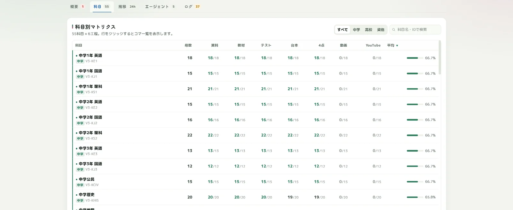

# 08. BI ダッシュボード

制作状況を可視化するローカルBIツールです。
**Python標準ライブラリのみ**で動き、パイプラインには一切書き込みません。

## 起動

```bash
py run_bi.py                                  # → http://127.0.0.1:8787
py パイプライン/bi/server.py --no-browser --port 8787
py パイプライン/bi/collect.py --out 一時/bi/snapshot.json --pretty
```

デスクトップのショートカットからも起動できます。既に起動中なら、
新しく立ち上げずにブラウザだけ開きます。

## なぜ作ったか

パイプラインが4本並列で走ると、「今どこまで進んだか」が分からなくなります。
ログを尾行する運用は、すぐに破綻します。

必要なのは監視ではなく、**判断できる1画面**でした。

- どの科目が、どの工程で、どこまで進んでいるか
- どのラインが止まっているか
- 今日どれだけ進んだか、このペースでいつ終わるか
- 何にお金を使っているか

## 指標の定義

| 指標 | 定義 |
|---|---|
| 資料パック | `pack.json` が存在するコマ |
| Webテキスト | `text.json` が存在するコマ |
| 診断テスト | `test.json` が存在するコマ |
| 台本 | `script.md` が存在するコマ |
| **4点セット** | 上記4つが揃ったコマ（動画前の完成度） |
| 動画 | `video.mp4` が存在するコマ |
| YouTube公開 | `status.json` に `youtube_id` があるコマ |
| **完全完成** | 4点セット＋動画＋YouTube公開が揃ったコマ |

平均進捗は **6工程の平均**です。

```text
平均進捗 = (6工程の完了数合計) ÷ (6 × コマ数) × 100

例: 18コマすべて4点セット済み、動画0、YouTube0
    (18+18+18+18+0+0) ÷ (6×18) × 100 = 66.7%
```

100%になるのは、その科目の全コマがYouTube公開まで終わったときだけです。
「4点セット」と「完全完成」を分けているのは、
**動画前のコンテンツ完成度**と**公開済み**を混同しないためです。



## 画面構成

| タブ | 内容 |
|---|---|
| **概要** | ステータスのひとこと、制作ライン、KPI、サイト公開、工程別到達度、アラート |
| **科目** | 55科目 × 6工程のマトリクス。検索・区分絞込・ソート・行クリックでコマ一覧 |
| **推移** | 24時間／7日間の生産数、14日間の累計、ライン別・モデル別コスト |
| **エージェント** | 4ライン＋節サムネの状態、現在のモデル、実行コマンド、モデル別利用 |
| **ログ** | 最近の完了12件、重複を除いた最新12件の失敗 |

### アラート

「見るべきこと」だけを自動判定します。

- ラインの**停止**（プロセスなし＋成果物の更新が閾値超過）
- **滞留**（プロセスはあるが成果物が進んでいない）
- サイトの**未反映**（生成済みだが未デプロイ）
- 失敗ログの蓄積
- ディスク残量

## 実装上の判断

### 依存ゼロ

FlaskもDBも使いません。`http.server` でJSONを返し、フロントは素のJSです。
**配布して動かなくなる要素を減らす**ためです。

### 読み取り専用

BIは `pack.json` などの存在と更新時刻、`status.json`、プロセス一覧を読むだけです。
パイプラインの再起動・修正・デプロイは行いません。
監視ツールのバグが制作を止めないようにするための線引きです。

### キャッシュ

1,146コマを毎回走査すると重いので、二段のキャッシュを持っています。

| 対象 | TTL |
|---|---|
| スナップショット全体 | 8秒 |
| プロセス検出 | 15秒 |

ブラウザ側は初期状態で**自動更新オフ**。画面を開いたときに1回だけ取得し、
必要なら10秒／30秒／1分／5分から選べます。
タブが非表示の間は更新を止め、戻ったときに再開します。

### ログの読み方

巨大なログを全読みしません。**末尾96KBだけ**を読みます。
1,146コマ分のログが溜まっても、メモリ使用量が一定に保たれます。

## デザイン

2026年のBI事例（Metabase、Superset、Grafana、Plausible、Umami など）を参考に、
**静かなクローム**で作りました。

- 影・境界・装飾を抑え、情報密度とタイポグラフィで階層を作る
- 表を主役に。グラフは傾向が必要な箇所だけ
- 色は意味に使う（緑＝正常、橙＝滞留、赤＝停止）
- 数字は `tabular-nums` で桁を揃える
- 鮮度を常に表示（最終更新・次回更新・各ラインの最終生成）
- 段階的開示（科目行をクリックしたときだけコマ一覧）

テーマは ライト（緑）／ライト（桃）／ナイト の3種類。設定とタブは `localStorage` に保存されます。

## 限界

- **ローカル専用**。127.0.0.1 のみで待ち受け、外部公開しません
- 複数人での共有は想定していません
- 生産数の推移はファイルの更新時刻から復元した**概算**です
- 集計はフルスキャンなので、コマ数が数千を超えると別の設計が必要になります
