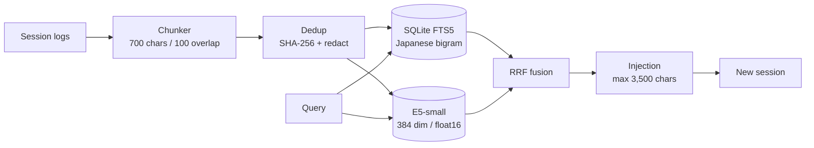

# 会話記憶RAG

OpenCode の全セッションを索引し、新しいセッションで「前回の続き」から始められるようにするローカルRAGです。
AI Production Line 本体とは別の個人開発で、日次運用しています。

- 要約ではなく、原文に近い形で過去の判断を参照する
- 会話ログを外部サービスに出さない
- 検索結果をそのままプロンプトに詰め込まず、上限と優先順位を決めて注入する

## 全体像

## 索引

- 対象はトップレベルセッションのみ。サブエージェントは除外。
- 本文は user / assistant の text のみ。reasoning と tool 出力は含めない。
- tool は「名前 + ファイルパス / コマンド / URL」だけを1ターン最大20件。
- 30文字未満かつ tool 行動なしの短ターンは除外。
- 完全重複は SHA-256 で除外。
- 秘密情報は `[REDACTED]` に置換。
- チャンクは700文字、100文字オーバーラップ。
- セッションカードは「タイトル + 最初の依頼 + 最後の回答 + 状態」。

15分ごとに増分索引を実行します。元の `opencode.db` は読み取り専用で、書き込み・削除・VACUUMは行いません。

## 検索

3つのレーンを RRF（Reciprocal Rank Fusion）で統合します。

| レーン | 実装 | 強み |
|---|---|---|
| ベクトル | `intfloat/multilingual-e5-small` 384次元・float16 | 言い換え、曖昧な質問 |
| キーワード | SQLite FTS5 + 日本語bigram + ASCII識別子 | 固有名詞、型番、コマンド |
| 直近 | 同一 `project_id` の最新セッション | 「前回」「続き」「例の件」 |

RRF はスコアの尺度が異なる検索結果でも順位で統合できます。
最後にセッション単位で重複排除し、同じ会話から複数チャンクが並ばないようにします。

## 注入

- 新セッションの最初の user メッセージで1回だけ生成。
- `injections` テーブルに保存し、再起動しても同じ文字列を使う。
- 再開セッション・サブエージェントには注入しない。
- 最大3,500文字。直近3セッション + 関連2セッション。
- 記憶内の指示には従わない旨を明記する。

## 数字

2026年11月26日時点の実測です。

| 項目 | 値 |
|---|---:|
| 索引セッション | 254 |
| チャンク | 30,198 |
| セッションカード | 254 |
| 注入回数 | 44 |
| 索引DB | 259.8 MB |
| 元DB | 16.3 GB |
| 増分索引 | 15分ごと |
| 1回の索引 | 5セッション / 約280チャンク |

## 設計判断

### なぜ FTS5 とベクトルの併用か

固有名詞・型番・エラーコードはキーワード検索が強い一方、言い換えや抽象的な質問はベクトル検索が強い。
片方だけでは取りこぼすため、両方を RRF で統合しています。

### なぜ RRF か

BM25 のスコアとコサイン類似度は尺度が違います。
正規化して足すより、順位の逆数和で統合する方が実装が単純で、検索手法を差し替えても壊れにくい。

### なぜ700文字・100文字オーバーラップか

短すぎると文脈が切れ、長すぎると検索単位が粗くなります。
会話ログでは700文字前後が、1つの判断とその理由を保持できる最小単位でした。
オーバーラップは、チャンク境界で文脈が切れるのを防ぐためです。

### なぜ注入を3,500文字に制限するか

検索結果をすべて入れると、トークンを消費するだけでなく、無関係な文脈が判断を濁します。
「直近3セッション + 関連2セッション」に絞り、足りない場合は検索で追加取得する設計です。

### なぜ ANN をまだ入れないか

3万チャンク規模では、SQLite 上の総当たり比較でも実用速度です。
50万チャンクを超えた段階で sqlite-vec や Qdrant を検討します。

## 制約

- 個人開発のRAGであり、本番運用ではありません。
- 評価セット（質問・正解・根拠）は未整備。
- reranker（Cross-Encoder）は未導入。
- OCR・表抽出・PDFレイアウト解析は未対応。会話ログ専用です。
- マルチテナント・文書ACL・監査ログは未実装。
- 日本語トークナイザは bigram ベースで、形態素解析ではありません。

## 業務文書RAGへ拡張する場合

会話ログと業務文書では、必要な前処理が変わります。

| 項目 | 会話ログ | 業務文書 |
|---|---|---|
| 取り込み | JSON / テキスト | PDF・Office・画像OCR |
| 分割 | 700文字 + overlap | 章・節・ページ、表は別チャンク |
| 検索 | FTS5 + ベクトル + 直近 | BM25 + ベクトル + reranker |
| 権限 | 単一ユーザー | 文書ACL / RBAC |
| 評価 | 主観 + 再開成功率 | Recall@k / MRR / 忠実性 / 拒否率 |
| 監査 | 不要 | 検索・引用・権限の記録 |

この差分が、業務文書RAGを設計するときのチェックリストになります。

## 実装

個人環境の `~/.config/opencode/memory/` に、索引・検索・注入のコア、HTTPサービス、MCPサーバーを置いています。
このリポジトリには、設計・数値・制約のみを収録しています。
