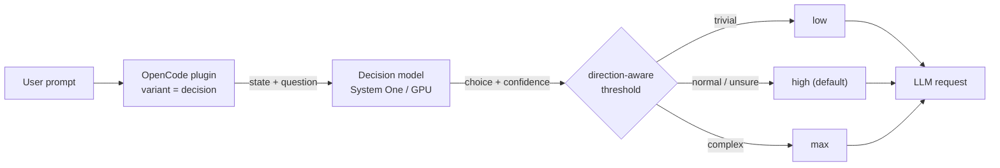

# 判断レイヤ（Decision Gate）

テキストを生成しない**判断モデル**に、LLMの推論強度（low / high / max）を選ばせます。
OpenCode のモデル強度に `decision` を1つ追加し、それを選んだときだけ判断モデルが動きます。

- 判定は1回のフォワードパス。文章は返らず、選択肢ごとの確率だけが返る
- 判定は **0.2〜0.5秒**。クラウドLLMに「この依頼は難しいですか」と聞くより桁で速い
- 強度の選択は**コスト非対称**なので、方向別にしきい値を分ける
- 判断モデルが落ちても、通常のLLM呼び出しは止めない（fail-open）

## 全体像



## 判定モデル

| 項目 | 値 |
|---|---|
| モデル | Strands Decider v2 E2B（Gemma 4 E2B ベース、Apache-2.0） |
| 重み | 10.25 GB（bf16） |
| 実行 | ローカルGPU / bf16 |
| VRAM | 9.77 GB |
| 判定時間 | **0.17〜0.47 秒**（GPU） |
| 参考: CPU | 5.5〜7.0 秒（毎ターン运用は不可） |
| 最大入力 | 8,192 tokens（用途上は数百文字で十分） |

モデルは `POST /v1/systemone` を話します。OpenCode 側は同じ形のエンドポイントなら何でも使えます。

```json
{
  "model": "strands-decider-e2b",
  "state": "この設計を批判的にレビューして改善案を出して",
  "questions": {
    "complexity": {
      "type": "choice",
      "instructions": "この依頼に必要な推論の深さは？",
      "criteria": {
        "trivial": "挨拶・定型質問・単純な変換・短い事実確認",
        "normal": "通常のコーディング・調査・要約・説明",
        "complex": "設計・難しいデバッグ・多段の推論・長い計画"
      }
    }
  }
}
```

返り値は選択肢ごとの確率と、校正済みの confidence です。

```json
{"answers":{"complexity":{"choice":"complex",
  "probabilities":{"trivial":0.004,"normal":0.100,"complex":0.896},
  "confidence":0.844}}}
```

## 方向別のしきい値

同じしきい値を全方向に使うと、**品質を落とす方向**と**コストが増えるだけの方向**を同じ強さで扱ってしまいます。
そこで方向別に分けています。

| 判定 | 適用 | confidence | margin | 理由 |
|---|---|---:|---:|---|
| trivial | `low` | 0.65 | 0.50 | 浅い推論で品質が落ちるため厳しめ |
| complex | `max` | 0.60 | 0.25 | コスト増だけで安全なため緩め |
| normal | 変更なし | — | — | 既定（high）と同じなので触らない |

`margin` は1位と2位の確率差です。confidence が同じでも、1位が僅差なら見送ります。
判断モデルの校正は「短い分類課題」で測られたもので、入力分布が変わればズレます。
そのため、確信度だけでなく**マージン**も条件にしています。

根拠にした公開情報:

- Strands Decider 公式: confidence 0.9 以上は約95%正解。ただし「自データでしきい値を決めろ」
- AWS の Rovy 事例: 2B 判定器で **0.70** を採用
- OpenCode の判断モデルプラグイン: 既定 **0.60**
- selective classification / margin-calibrated routing: 低マージンは人間・上位モデルへ回す

## 安全弁

- 入力が **500文字超**なら `low` にしない（長い依頼を軽く処理しない）
- 判定が **900ms** を超えたら既定（high）で続行
- 判定モデルが落ちてもリクエストは止めない
- `Default / Low / High / Max` を明示選択したときは、判定を通さずそのまま使う
- 同じターンのツール継続では再判定しない（判断は1ターン1回）

## ログと再校正

判定ごとに JSONL で記録します。

```json
{"event":"decision","ms":474,"choice":"complex","confidence":0.8438,
 "margin":0.7957,"threshold":{"confidence":0.6,"margin":0.25},
 "accepted":true,"effort":"max"}
```

数百件たまったら、confidence のバケットごとに「その強度で正しかったか」を集計し、
しきい値を自分のトラフィックに合わせ直します。判断モデルの校正値はベンダーの
ベンチマーク上の値であり、自分の入力分布では別物だからです。

## 実装

- `src/llm/decision_gate.py` — System One クライアントと方針（標準ライブラリのみ）
- `samples/opencode-auto-effort/index.ts` — OpenCode プラグインの例（variant 追加 + resolve フック）

```bash
python -m src.llm.decision_gate \
  --endpoint http://127.0.0.1:8001 \
  --state "この設計を批判的にレビューして改善案を出して"
```

## 設計判断

### なぜ「モデル」ではなく「強度」を選ぶのか

プロバイダをまたぐモデル選択は、認証・課金・コンテキスト長の差が大きく、失敗時の影響も大きい。
一方、同じモデルの強度変更は同一プロバイダ内で完結し、戻すのも簡単です。
まず強度だけを動かし、モデル選択は別レイヤに分けています。

### なぜプロキシを挟まないのか

OpenCode の `experimental.model.resolve` は、リクエスト直前のモデル参照を書き換えられます。
同一プロバイダ内なら API キーの中継もストリーミングの再実装も不要です。
プロキシはモデルをまたぐ必要が出たときだけ導入すれば十分です。

### なぜ12Bや31Bを選ばなかったのか

12B は bf16 で 22.3GB（推奨48GB）、31B は 4bit でも 17GB 必要で、12GBのカードに載りません。
E2B は bf16 で 10.25GB に収まり、判定用途では十分な精度が出ます。
一方、判断モデルが 9.8GB の VRAM を使うため、12B のチャットモデル（8.9GB）とは同時に動きません。
「判断だけ」「生成だけ」を切り替える運用にしています。

### 失敗した選択肢

- CPU 実行: 5.5〜7.0秒/判定。毎ターンでは体感を損なう
- 12B bf16: 推奨48GBで12GBに載らない
- 31B 4bit: 17GBで12GBに載らない
- vLLM の 4bit: 量子化は適合するが、プラグインが Ampere（RTX 3060）非対応

## 参考

- Strands Decider v2（Apache-2.0）: https://github.com/strands-labs/strands-decider
- Strands Agents blog: https://strandsagents.com/blog/introducing-strands-decider-v2/
- Rovy（AWS Builder Center）: https://builder.aws.com/content/3KrGCFSzyZZ7WmYS8lrzps4k0ZD/rovy-a-decision-making-martian-rover-agent-powered-by-strands-decider-2b
- RouteLLM（しきい値の校正）: https://github.com/lm-sys/RouteLLM
